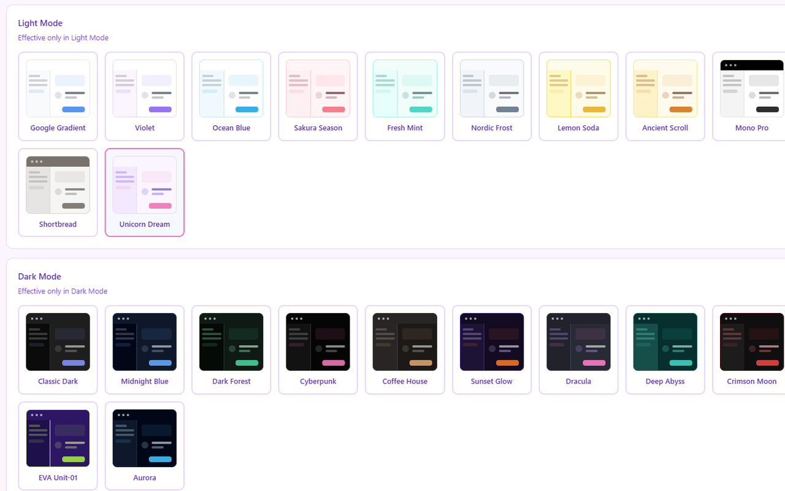

import { Shortcut } from "/snippets/shortcut.jsx"
import { ThemePresetGrid } from "/snippets/theme-preset-grid.jsx"

Ophel ships with 24 built-in theme presets (12 light and 12 dark), per-site theme memory, native page theme syncing, and a live Custom CSS editor.



<Note>
Open **Settings → Appearance** from the side panel inside any supported AI tab. When you open the standalone extension Options page directly without a content script attached, the **Appearance** menu item is hidden automatically.
</Note>

## Light, dark, and system mode

Each site remembers its own theme mode and preset independently. Switch modes anytime by:

- Pressing <Shortcut combo="alt+d" /> (toggles light / dark with a circular transition from your cursor or button).
- Clicking the theme icon in the panel header or floating quick buttons.
- Choosing **Light**, **Dark**, or **System** at the bottom of the Settings sidebar.

### Sync native page theme

**Sync Native Page Theme** (default **On**, at the top of **Settings → Appearance**) automatically switches the underlying AI website between light and dark mode whenever you toggle Ophel's theme.

- Supported on **15 of 16 built-in sites** (all except **ima**).
- Supported on Site Packs that declare `themeSync` (Perplexity, WorkBuddy, LobeChat, StepFun, Zhihu Zhida).

## Built-in theme presets (24)

Open **Settings → Appearance → Theme Presets** and click any card to apply it immediately. You pick one preset for Light mode and one for Dark mode.

<Tabs>
  <Tab title="Light presets (12)">
    <ThemePresetGrid mode="light" locale="en" />
  </Tab>
  <Tab title="Dark presets (12)">
    <ThemePresetGrid mode="dark" locale="en" />
  </Tab>
</Tabs>

## Custom CSS

Open **Settings → Appearance → Custom Styles** to create your own light or dark styles. Saved custom styles appear right alongside built-in presets so you can reuse and switch between them per site, and edits take effect immediately without refreshing.

Because Ophel renders inside a Shadow DOM, target `:host` and override Ophel's `--gh-*` CSS variables:

```css
:host {
  --gh-primary: #0f766e;
  --gh-bg: #fcfcfb;
  --gh-header-bg: linear-gradient(135deg, #0f766e 0%, #0284c7 100%);
  --gh-header-text: #ffffff;
  --gh-font-family: "Inter", system-ui, sans-serif;
}
```

### Commonly overridden CSS variables

| Variable | Controls |
| --- | --- |
| `--gh-bg` | Main panel and card background |
| `--gh-bg-secondary` | Subtle secondary surface background |
| `--gh-text` | Primary text color |
| `--gh-text-secondary` | Secondary / muted text color |
| `--gh-primary` | Accent color for buttons, active states, and highlights |
| `--gh-primary-text` | Readable accent text/icon variant |
| `--gh-border` | Borders and dividers |
| `--gh-shadow` | Panel drop shadow |
| `--gh-header-bg` | Panel header background (solid color or CSS gradient) |
| `--gh-header-text` | Panel header title and icon color |
| `--gh-hover` | Row and button hover background |
| `--gh-danger` | Destructive action accent color |
| `--gh-font-family` | UI font stack inside Ophel |

<Tip>
`--gh-header-bg` accepts any valid CSS `background` value, including gradients such as `linear-gradient(135deg, #1e40af 0%, #3b82f6 100%)`.
</Tip>
