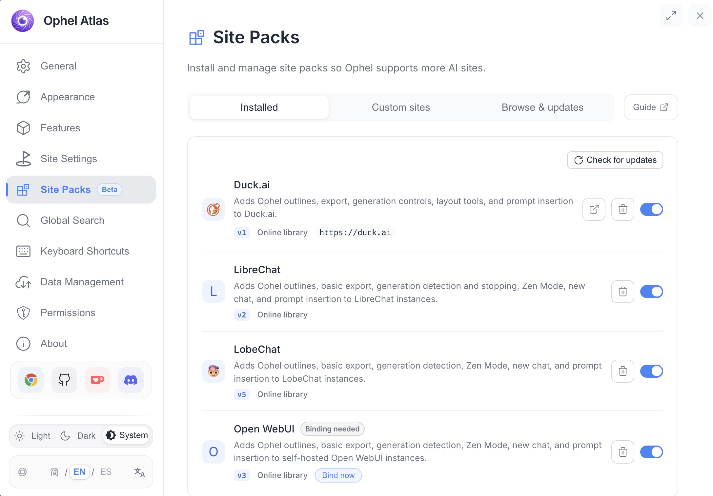

Beyond the 16 built-in platforms, **Site Packs** let you add support for more AI websites—such as Perplexity, WorkBuddy, Notion AI, Manus, Open WebUI, and LibreChat—without waiting for a full extension release.

You manage built-in sites, installed packs, custom self-hosted URLs, and updates from one screen: **Settings → Site Packs**.

## Built-in sites vs. Site Packs

| Aspect | Built-in sites (16) | Site Packs (18 in community library) |
| --- | --- | --- |
| **Setup** | Works immediately after install (except Gemini Enterprise, which starts disabled) | Install in one click from **Browse & updates**, or import a local JSON file |
| **Capabilities** | Full custom adapters (history APIs, multi-account sync, site-specific settings, chat list sync) | Declarative JSON definitions covering outline, basic export, prompt insert, width, Zen/Clean Mode, generation detection, and theme sync |
| **Self-hosted apps** | Fixed public domains | Bind any exact `http://` or `https://` origin (including local LAN servers) |
| **Updates** | Updated with Ophel releases (plus optional selector hotfix patches) | Updated automatically from the signed online library (checked every 24 hours) |

<Note>
A Site Pack cannot run JavaScript or arbitrary code—it only declares page selectors, layout rules, and safe options. Packs cannot override an enabled built-in site (if you disable a built-in site first, a Site Pack can take over).
</Note>

## The four tabs in Site Packs

Open **Settings → Site Packs** to see four tabs (plus a **Guide** button in the top-right):

1. **Built-in sites**: Enable or disable any of the 16 built-in platforms and jump straight to its **Site Settings**.
2. **Installed**: Enable, disable, update, or uninstall your installed Site Packs.
3. **Custom sites**: Bind an installed Site Pack to your own self-hosted address (for example `https://chat.company.internal` or `http://192.168.1.10:3000`).
4. **Browse & updates**: Search and install packs from the online library, import a local JSON pack, trigger manual update checks, or open the collapsed **Built-in Config Patches** section for debugging.

## Available community Site Packs

The community library currently provides **18 Site Packs** (14 with default domains and 4 self-hosted packs):

### Ready-to-use sites (14)

| Site Pack | Default URL(s) | Key capabilities |
| --- | --- | --- |
| **Perplexity** | `www.perplexity.ai` | Outline, export, prompts, width, Zen Mode, theme sync |
| **WorkBuddy** | `www.workbuddy.cn/app`, `www.workbuddy.ai/app` | Outline, export, prompts, generation detect, panel avoidance, width, Zen & Clean Mode, theme sync |
| **Notion AI** | `app.notion.com/ai*`, `app.notion.com/chat*` | Outline, export, prompts, width, Zen Mode |
| **Manus** | `manus.im` | Outline, export, prompts, width, Zen & Clean Mode, Mermaid fallback |
| **Genspark** | `www.genspark.ai` | Outline, export, prompts, generation detect, width, Zen & Clean Mode |
| **Duck.ai** | `duck.ai` | Outline, export, prompts, generation detect, width, Zen Mode |
| **Proton Lumo** | `lumo.proton.me` | Outline, export, prompts, generation detect, width, Zen & Clean Mode |
| **LobeChat** | `app.lobehub.com` *(also supports custom self-hosted URLs)* | Outline, export, prompts, generation detect, panel avoidance, Zen Mode, theme sync |
| **StepFun** | `chat.stepfun.com` | Outline, export, prompts, generation detect, panel avoidance, width, Zen Mode, theme sync |
| **LongCat AI** | `longcat.chat` | Outline, export, prompts, generation detect, width, Zen Mode |
| **Baidu Wenxin** | `wenxin.baidu.com` | Outline, export, prompts, width, Zen Mode |
| **Zhihu Zhida** | `zhida.zhihu.com` | Outline, export, prompts, width, Zen Mode, theme sync |
| **OpenCode Share** | `opncd.ai` | Read-only share pages: outline, export, Mermaid fallback |
| **Muse** *(requires Ophel v1.3.7+)* | `muse.ai` | Minimal enhancement mode: outline, export, prompts, width, Zen Mode (main & side chats) |

### Self-hosted packs (4 — bind your own URL after install)

| Site Pack | Key capabilities |
| --- | --- |
| **Open WebUI** | Outline, export, prompts, generation detect, Zen Mode |
| **LibreChat** | Outline, export, prompts, generation detect, Zen Mode |
| **NextChat** | Outline, export, prompts, Zen Mode |
| **DeepSeek Harness** | Outline, export, prompts, generation detect, width, Zen Mode, reading history |

## Security at a glance

- **No executable code**: Every Site Pack is a validated JSON file (`≤ 64 KiB`)—no remote JS or unrestricted CSS.
- **Verified downloads**: The online library index is signed with Ed25519 and every pack is verified against its SHA-256 hash before applying. If an update fails validation, Ophel keeps your previous working version.
- **Scoped permissions**: Extension builds ask permission only for the specific site origin(s) a pack needs and revoke unused managed origins automatically when you uninstall.

## Next steps

<CardGroup cols={2}>
  <Card title="Install & Manage" icon="download" href="/enhancements/site-extensions/installation">
    Step-by-step instructions for online install, local JSON import, and binding self-hosted URLs.
  </Card>
  <Card title="Site Packs FAQ" icon="circle-question" href="/enhancements/site-extensions/faq">
    Answers on updates, permissions, data isolation, and troubleshooting broken sites.
  </Card>
  <Card title="Capabilities Reference (Authors)" icon="list-check" href="/enhancements/site-extensions/capabilities">
    Reference of all 15 Site Pack capability IDs for pack authors.
  </Card>
  <Card title="Author a Site Pack" icon="code" href="/enhancements/site-extensions/authoring">
    Write a declarative JSON Site Pack, test it locally, and submit it to the community library.
  </Card>
</CardGroup>
