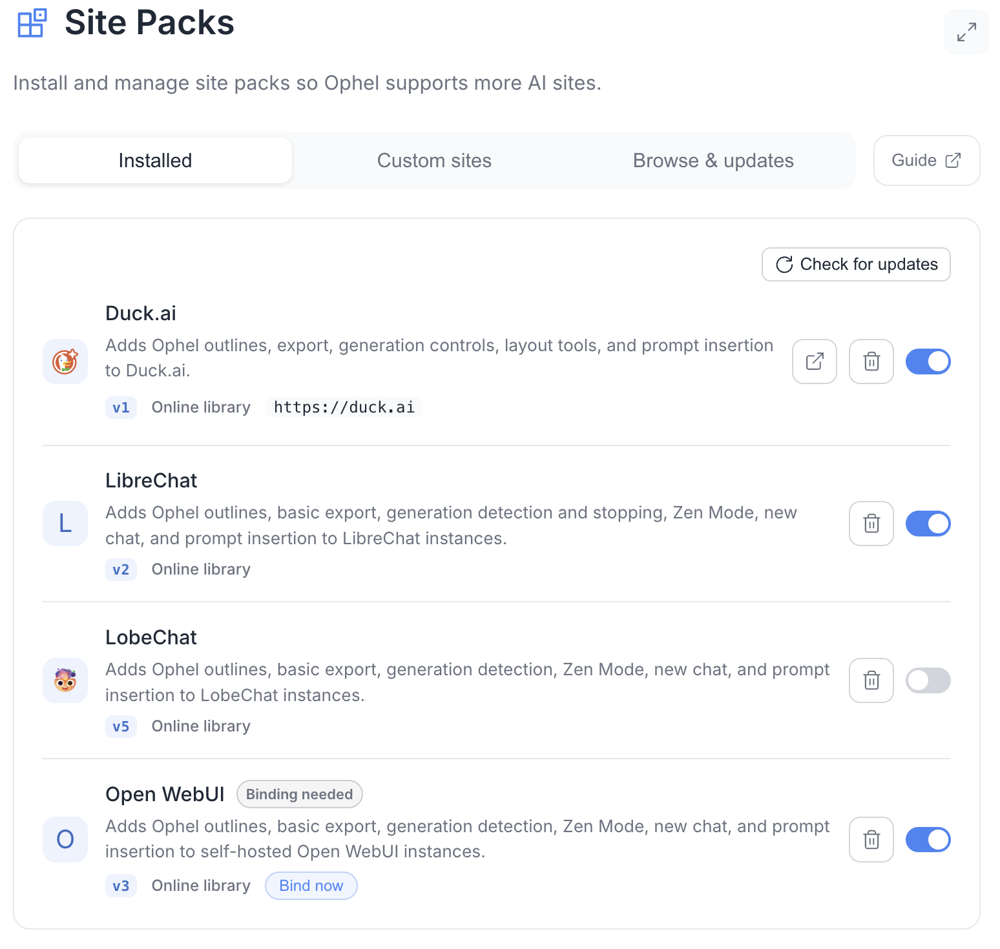
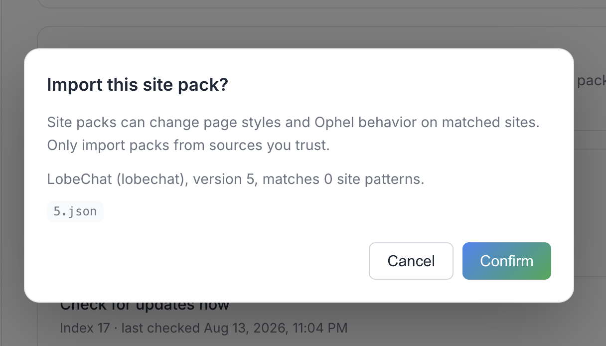
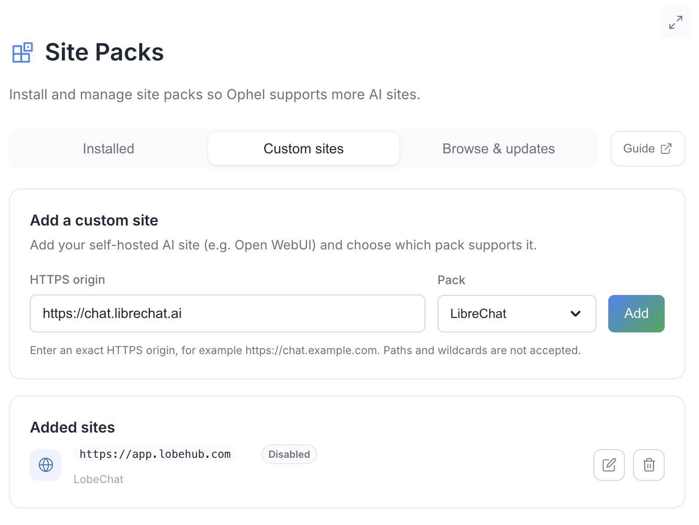
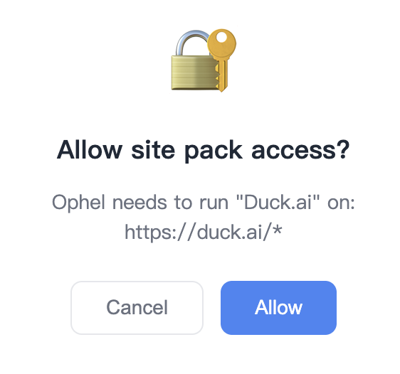

This guide covers installing, binding, updating, and removing Site Packs in **Settings → Site Packs**.

## Install from the online library

<Steps>
  <Step title="Open Browse & updates">
    Go to **Settings → Site Packs → Browse & updates**.
  </Step>
  <Step title="Search and install">
    Find the site you want and click **Install**.
  </Step>
  <Step title="Approve site access (extension builds)">
    Your browser will ask to grant Ophel access to that site's domain. Approve the prompt so Ophel can mount on the page. If you decline, installation is rolled back cleanly.
  </Step>
  <Step title="Open the site">
    Click **Open site** (or refresh an already-open tab) to start using Ophel there.
  </Step>
</Steps>

<Note>
By default, Ophel fetches the signed index from jsDelivr (`cdn.jsdelivr.net/gh/urzeye/ophel@registry-dist/index.json`) with GitHub raw (`raw.githubusercontent.com/urzeye/ophel/registry-dist/index.json`) as a fallback, checking once every **24 hours** when auto-update is enabled.
</Note>

## Import a local JSON pack

Use local import if you created your own pack or received a `.json` pack file to test:

<Steps>
  <Step title="Open Browse & updates">
    Go to **Settings → Site Packs → Browse & updates** and choose **Import pack from file**.
  </Step>
  <Step title="Review validation and summary">
    Ophel validates the file format, size, selectors, and patterns, then shows the pack ID, version, and matched URLs before saving.
  </Step>
  <Step title="Confirm and authorize">
    Confirm the import and approve the site permission prompt if using the extension build.
  </Step>
</Steps>

<Warning>
Locally imported packs are not signed by the online library and do **not** auto-update. Only import JSON files from sources you trust.
</Warning>

## Bind a custom self-hosted URL

For self-hosted packs (such as **Open WebUI**, **LibreChat**, **NextChat**, or **DeepSeek Harness**) — or your own self-hosted **LobeChat** — bind the exact site address you visit:

<Steps>
  <Step title="Install the pack first">
    Install the matching pack from **Browse & updates** (it will show a **Self-hosted / Binding needed** badge until you bind a URL).
  </Step>
  <Step title="Open Custom sites">
    Switch to **Settings → Site Packs → Custom sites** (or click **Bind now** on the pack card).
  </Step>
  <Step title="Enter your site origin">
    Pick the installed pack and enter the exact origin, including scheme and port if needed — both `https://` and `http://` are supported (for example `https://ai.example.com` or `http://192.168.1.10:3000`). Do not include a path or wildcard.
  </Step>
  <Step title="Save and grant permission">
    Save the binding and approve browser access for that origin.
  </Step>
</Steps>

- **Separate data per address**: If you bind the same Site Pack to two different servers (such as work and home Open WebUI instances), Ophel keeps their site settings, bookmarks, and reading history completely separate.

## How permissions differ by platform

- **Chrome / Edge / Firefox extensions**: Ophel requests host access only for the specific site origin(s) required by each pack and registers its content scripts dynamically. When you disable or uninstall a pack—or remove a custom binding—Ophel unregisters the scripts and revokes managed origin permissions that no other pack uses.
- **After restoring a backup**: Restored Site Packs keep their settings, and an inline **Reauthorize restored site packs** section lets you re-approve their host permissions in one click.
- **Safari (macOS)**: Safari manages website access in **Safari → Settings → Extensions → Ophel Atlas**. Ophel displays guided instructions rather than a popup permission dialog.
- **Userscript**: Userscript builds do not prompt for per-site browser permissions because the script matches sites locally via its whitelist. If you manually restricted `@match` rules in your script manager, Ophel lists any uncovered custom origins so you can add them.

## Update, disable, or uninstall

- **Check for updates**: Click **Check updates** in **Installed** or **Browse & updates** to refresh the online library and apply compatible updates to installed online packs.
- **Disable**: Toggle a pack off in **Installed** to stop Ophel from running on its sites without deleting your settings or bindings.
- **Uninstall**: Removes the pack and its custom bindings. Your site layout preferences and local data are preserved in case you reinstall later.

## Status badges

| Badge | Meaning |
| --- | --- |
| **Available** | Installed, enabled, and ready to run. |
| **Disabled** | Installed but turned off. |
| **Self-hosted** / **Binding needed** | Installed pack has no default public URL; bind your own address in **Custom sites**. |
| **Incompatible** | Pack requires a newer Ophel version (`Requires Ophel X.Y.Z or newer`). Update Ophel to enable it. |
| **Removed from library** | Pack is no longer listed in the online library; your installed copy remains usable until you uninstall it. |
| **Online library** / **Local import** | Shows whether the pack auto-updates from the online library or was imported manually. |
