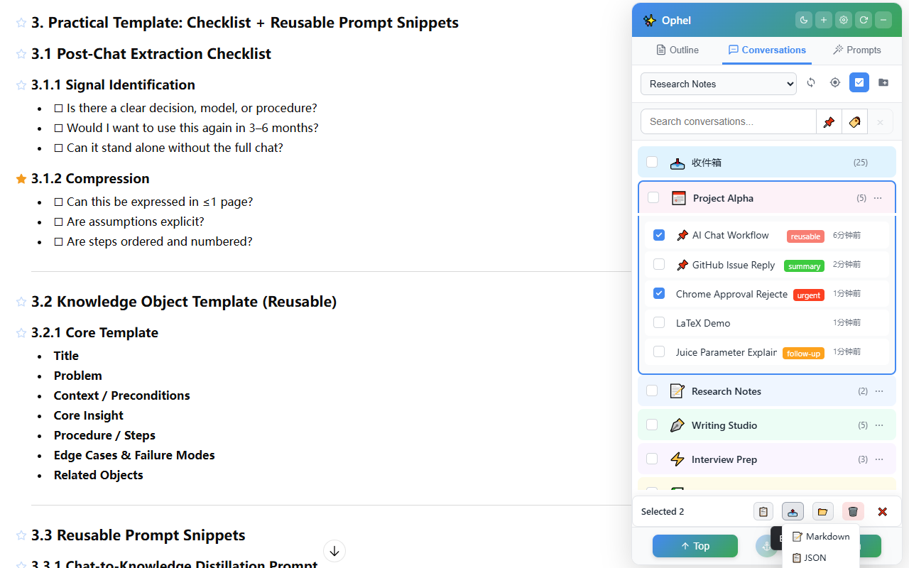

import { Icon } from "/snippets/icon.jsx"
import { Shortcut } from "/snippets/shortcut.jsx"

The **Chats** tab gives you flat project folders, multi-tag filters, pins, search, and batch actions on top of each platform's own chat list.

<Note>
**Supported sites**: The **Chats** tab appears on the **11 built-in platforms** that expose a chat history list: ChatGPT, Gemini, Gemini Enterprise, AI Studio, Claude, Grok, DeepSeek, Doubao / Dola, Kimi, Qwen Studio, and Yuanbao. Sites without a sidebar chat list (Gemini Notebook, ChatGLM, ima, Qianwen, Z.ai, and current Site Packs) hide the tab and skip sync automatically.
</Note>

## How chat sync works

Ophel reads chat titles and URLs from the current site (via API pagination on Claude, Grok, and Qwen Studio, or sidebar scanning on other platforms) and stores only metadata locally (title, URL, folder, tags, pin state). Your message contents stay on the AI platform.

- **Bounded initial & manual sync**: Full sync runs with a progress bar and a **Stop** button (up to 120 seconds total, 90 seconds of DOM scrolling), writing batches as it goes. If you click the native sidebar or navigate away, Ophel yields control immediately.
- **Safe cleanup with review & undo**: Ophel never silently deletes your local folders, tags, or pins when a sync is interrupted or returns empty. Only after a complete manual sync succeeds with non-empty results does Ophel gather records missing from the platform and open the **Missing Chats Review** dialog.
  - Inside the review dialog, you can search, select all/invert, or open original links to verify before cleaning.
  - Confirming cleanup removes **only Ophel's local metadata**—it never deletes chats on the AI site.
  - A **5-second undo toast** appears afterward (pausing automatically while hovered or when you switch tabs) so you can restore cleaned batches immediately.
- **In-page navigation**: Clicking a chat on built-in sites switches within the page whenever possible (preserving ChatGPT Project and GPT chat URLs) instead of forcing a full reload.

## Account, workspace, and domain isolation

Ophel keeps local chat lists separated so switching accounts does not mix your history:

- **Account & workspace isolation**: ChatGPT separates chats by personal/team workspace; Claude separates by account and organization; Grok, AI Studio, Gemini, DeepSeek, Kimi, Qwen Studio, and Yuanbao separate by signed-in account. If the page has not resolved your account identity yet, Ophel waits instead of syncing into the wrong bucket.
- **Multi-domain isolation**: Platforms that share one built-in adapter across multiple hosts (**Doubao** `doubao.com` vs. **Dola** `dola.com`; **Kimi** `.com` vs. `.ai`; **Z.ai** `chat.z.ai` vs. `zchat.z.ai`) share Ophel settings but keep local chats, bookmarks, and reading progress isolated per domain.

## Folders, tags, and pins

The top toolbar provides <Icon src="/images/icons/folder-plus.svg" alt="New folder icon" /> **New Folder**, <Icon src="/images/icons/batch.svg" alt="Batch mode icon" /> **Batch Mode**, <Icon src="/images/icons/locate.svg" alt="Locate icon" /> **Locate Current Chat**, and <Icon src="/images/icons/sync.svg" alt="Sync icon" /> **Sync** alongside the **target folder dropdown** on the right (which chooses where newly synced chats land). Below it, the filter bar combines <Icon src="/images/icons/search.svg" alt="Search icon" /> search with <Icon src="/images/icons/pin.svg" alt="Pinned filter icon" /> **Pinned Only**, <Icon src="/images/icons/tag.svg" alt="Tag filter icon" /> **Tag Filter**, and <Icon src="/images/icons/clear.svg" alt="Clear filters icon" /> **Clear Filters**.

- <Icon src="/images/icons/folder.svg" alt="Folder icon" /> **Folders (single-level)**: Every chat belongs to one folder (defaulting to the pinned **Inbox** folder). Click <Icon src="/images/icons/folder-plus.svg" alt="New folder icon" /> to create custom folders with a name and any of 64 emoji presets, drag folders to reorder them, and drag chats onto a folder (or use <Icon src="/images/icons/folder-move.svg" alt="Move icon" /> **Move** from the chat menu or <Icon src="/images/icons/tools.svg" alt="Toolbox icon" /> **Toolbox**) to file them.
- <Icon src="/images/icons/tag.svg" alt="Tag icon" /> **Tags**: Attach multiple color-coded tags (30 preset colors) to any chat and filter by tag.
- <Icon src="/images/icons/pin.svg" alt="Pin icon" /> **Pins**: Pin important chats to the top of their folder. Optionally sync unpinning back to the platform.
- **Chat row menu** (<Icon src="/images/icons/more-horizontal.svg" alt="More menu icon" /> or right-click any row): <Icon src="/images/icons/link.svg" alt="Open in new tab icon" /> **Open in new tab**, <Icon src="/images/icons/rename.svg" alt="Rename icon" /> **Rename**, <Icon src="/images/icons/pin.svg" alt="Pin icon" /> **Pin / Unpin**, <Icon src="/images/icons/tag.svg" alt="Tag icon" /> **Set tags**, <Icon src="/images/icons/folder-move.svg" alt="Move icon" /> **Move**, <Icon src="/images/icons/export.svg" alt="Export icon" /> **Export**, and <Icon src="/images/icons/delete.svg" alt="Delete icon" /> **Delete**.

## Batch actions

Click the <Icon src="/images/icons/batch.svg" alt="Batch mode icon" /> batch button in the **Chats** toolbar to select multiple chats (hold `Shift` to select a range, or select an entire folder):

- <Icon src="/images/icons/pin.svg" alt="Pin icon" /> **Pin / Unpin**, <Icon src="/images/icons/folder-move.svg" alt="Move icon" /> **Move to folder**, <Icon src="/images/icons/tag.svg" alt="Tag icon" /> **Add or remove tags**, <Icon src="/images/icons/delete.svg" alt="Delete icon" /> **Delete**, and <Icon src="/images/icons/clear.svg" alt="Exit icon" /> **Exit**.
- <Icon src="/images/icons/export.svg" alt="Export icon" /> **Export**: Available when **exactly 1 chat** is selected (or use any chat row's <Icon src="/images/icons/more-horizontal.svg" alt="More menu icon" /> menu, or press <Shortcut combo="ctrl+shift+e" /> for the open chat). See [Chat Export](/features/export).

## Keyboard shortcuts

| Action | Default shortcut |
| --- | --- |
| <Icon src="/images/icons/edit.svg" alt="New chat icon" /> New chat | <Shortcut combo="ctrl+shift+o" /> |
| <Icon src="/images/icons/refresh.svg" alt="Refresh icon" /> Refresh chat list | <Shortcut combo="alt+shift+r" /> |
| <Icon src="/images/icons/locate.svg" alt="Locate icon" /> Locate current chat | <Shortcut combo="alt+shift+l" /> |
| <Icon src="/images/icons/chevron-up.svg" alt="Previous chat icon" /><Icon src="/images/icons/chevron-down.svg" alt="Next chat icon" /> Previous / Next chat | <Shortcut combo="alt+[" /> / <Shortcut combo="alt+]" /> |
| <Icon src="/images/icons/export.svg" alt="Export icon" /> Export current chat | <Shortcut combo="ctrl+shift+e" /> |
| <Icon src="/images/icons/copy.svg" alt="Copy icon" /> Copy latest AI reply | <Shortcut combo="ctrl+shift+c" /> |

## Settings

Open **Settings → Features → Chats**:

| Setting | Default | What it does |
| --- | --- | --- |
| **Folder Rainbow Colors** | On | Assigns soft alternating background tints to folders. |
| **Sync Unpin Status** | Off | Unpins the chat in Ophel if it is no longer pinned on the platform. |
| **Delete chat on site when deleting** | On | When you delete a chat in Ophel, also deletes the original chat on the AI platform. |

<Warning>
**Delete chat on site when deleting** is **On** by default. Deleting a chat from the **Chats** tab (or batch delete) will permanently remove the original conversation on the AI platform where supported. Turn this option **Off** if you only want to remove local entries from Ophel. (Cleanup inside **Missing Chats Review** always deletes local records only.)
</Warning>
