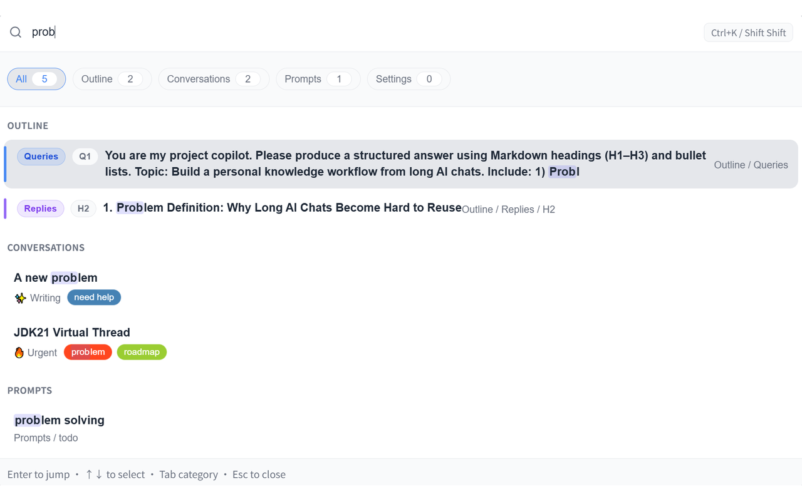

import { Icon } from "/snippets/icon.jsx"
import { Shortcut } from "/snippets/shortcut.jsx"

Global Search lets you jump to headings, saved chats, prompt templates, or settings pages from a single command palette.

## How to open Global Search

- Press <Shortcut combo="ctrl+k" /> (customizable in **Settings → Keyboard Shortcuts**).
- Click the <Icon src="/images/icons/search.svg" alt="Search icon" /> **Global Search** icon in the floating quick buttons.
- **Double-press `Shift`** (optional, off by default): Enable **Double Shift to open Global Search** in settings, then tap `Shift` twice within 360 ms anywhere on a supported AI tab—whether your cursor is inside the chat input or on the page—without opening the Ophel panel first. Pressing any other key in between cancels the trigger so normal typing is unaffected.

## What you can search

Switch result categories using `Tab` / `Shift+Tab` or click a category tab:

| Category | What it searches | Selection behavior |
| --- | --- | --- |
| <Icon src="/images/icons/search.svg" alt="All icon" /> **All** | Combined top results across categories | Runs the matched item's default action. |
| <Icon src="/images/icons/outline.svg" alt="Outline icon" /> **Outline** | Headings and user questions in the active chat | Scrolls straight to that node. |
| <Icon src="/images/icons/conversation.svg" alt="Chats icon" /> **Chats** | Synced chats on the current platform **and other supported platforms** (external results show the site icon) | Opens current-site chats in place; opens external-site chats in a new tab. |
| <Icon src="/images/icons/prompt.svg" alt="Prompts icon" /> **Prompts** | Titles, content, categories, and tags in your Prompt Library | Inserts the prompt (or opens the variable dialog), or locates it in the **Prompts** tab depending on your Enter behavior setting. |
| <Icon src="/images/icons/settings.svg" alt="Settings icon" /> **Settings** | Every Ophel setting page and option (including legacy aliases) | Opens the exact settings section and scrolls to the option. |
| <Icon src="/images/icons/features.svg" alt="Tips icon" /> **Tips** | Built-in feature tips and shortcuts | Browse shortcuts and tips directly in the palette. |

<Tip>
Hover a prompt result for ~0.5 s (or highlight it with arrow keys for ~0.7 s) to preview the full prompt content before inserting it.
</Tip>

## Query syntax filters

Combine free keywords with up to 6 structured operators. As you type, Ophel suggests matching values, shows active filter chips (up to 4 displayed), and flags syntax typos or conflicts. Click `?` in the search bar anytime to view the syntax reference.

| Operator | Applies to | Accepted values | Example |
| --- | --- | --- | --- |
| `type:` | All | `outline`, `conversations`, `prompts`, `settings` | `type:prompts review` |
| `folder:` | Chats | Folder name (partial match; includes `inbox`) | `folder:work roadmap` |
| `tag:` | Chats, Prompts | Tag name (partial match; repeat for AND logic) | `tag:sql tag:prod` |
| `is:` | Chats | `pinned`, `unpinned` | `is:pinned architecture` |
| `level:` | Outline | `0`–`6` (`0` = user questions, `1`–`6` = H1–H6) | `level:0 docker` |
| `date:` | Chats, Prompts | `Nd` (recent `N` days, e.g. `7d`, `30d`) | `date:7d migration` |

## Fuzzy search

By default, Global Search uses exact substring matching. Turn on **Enable fuzzy search** to match typos and partial characters (for example, `kafk` or `promtp`).

## Settings

Open **Settings → Features → Global Search**:

| Setting | Options | Default | What it does |
| --- | --- | --- | --- |
| **Enable Global Search** | On / Off | On | Master switch for Global Search. |
| **Double Shift to open Global Search** | On / Off | Off | Opens Global Search when pressing `Shift` twice quickly inside a supported tab. |
| **Enable fuzzy search** | On / Off | Off | Enables typo-tolerant fuzzy matching. |
| **Prompt Enter behavior** | Smart insert / Locate only | Smart insert | **Smart insert** fills variables or inserts directly into the chat input; **Locate only** opens the **Prompts** tab and highlights the prompt. |
