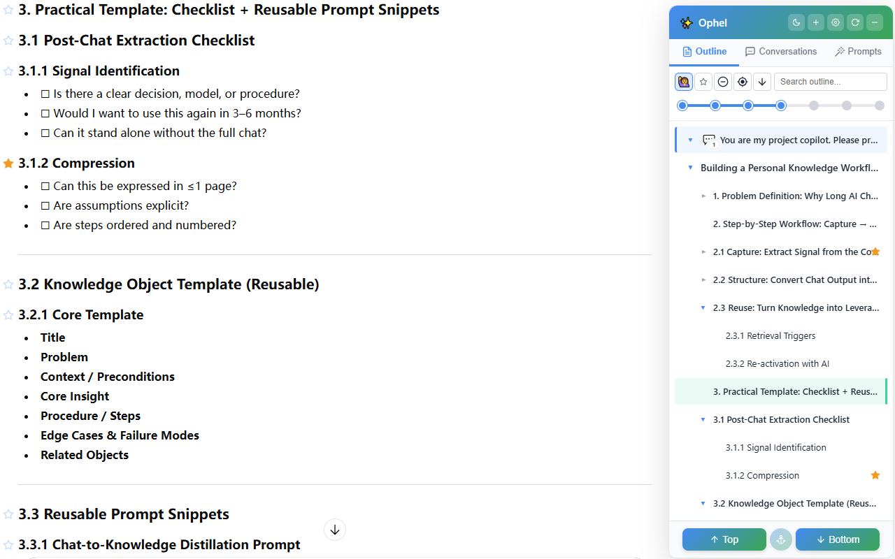

import { Icon } from "/snippets/icon.jsx"
import { Shortcut } from "/snippets/shortcut.jsx"

The **Outline** tab reads your prompts and the AI's Markdown headings (`H1`–`H6`) and arranges them into a live table of contents. Click any entry to jump straight to that spot in the conversation.

## How the outline is built

- **Real-time updates**: As replies stream in, Ophel refreshes the outline automatically (every **2 seconds** by default).
- **Virtual-scroll backfill**: Platforms that unload off-screen messages (such as DeepSeek, Claude, AI Studio, Grok, and Qwen Studio) use Ophel's history API loaders so earlier turns stay visible in the outline even before you scroll back up.
- **Level slider (`0`–`6`)**: Drag the slider in the outline toolbar to control how deep the tree expands. Level `0` shows only your questions; levels `1`–`6` expand headings down to that depth. You can also collapse or expand individual nodes, toggle all with <Shortcut combo="alt+e" />, or jump to a depth directly with <Shortcut combo="alt+shift+1" /> through <Shortcut combo="alt+shift+6" />.

## Document outline sources

On platforms that display a separate document or workspace alongside the chat, a <Icon src="/images/icons/outline-document.svg" alt="Document outline icon" /> source switcher appears at the top of the **Outline** tab:

| Platform | Available outline sources |
| --- | --- |
| <Icon src="/images/icons/gemini.png" alt="Gemini icon" /> **Gemini** | Chat conversation / Deep Research report / Canvas document |
| <Icon src="/images/icons/claude.svg" alt="Claude icon" /> **Claude** | Chat conversation / Artifact document panel |
| <Icon src="/images/icons/gemini-notebook.png" alt="Gemini Notebook icon" /> **Gemini Notebook** | Sources / Chat conversation / Studio outputs & notes |

## Toolbar controls and filtering

| Control | Shortcut | What it does |
| --- | --- | --- |
| <Icon src="/images/icons/search.svg" alt="Search icon" /> **Search box** | <Shortcut combo="alt+f" /> | Filters outline entries in real time with match counts and keyword highlights. |
| <Icon src="/images/icons/user-query.svg" alt="User question icon" /> **Show / Hide User Questions** | <Shortcut combo="alt+q" /> | Toggles whether your prompts appear in the outline tree. |
| <Icon src="/images/icons/user-query.svg" alt="User questions only icon" /> **User Questions Only** | <Shortcut combo="alt+shift+q" /> | Collapses the outline to level `0` so only your questions remain visible. |
| <Icon src="/images/icons/star.svg" alt="Bookmark icon" /> **Bookmarks Filter** | <Shortcut combo="alt+c" /> | Shows only bookmarked entries (disables the level slider while active). |
| <Icon src="/images/icons/expand-all.svg" alt="Expand icon" /><Icon src="/images/icons/collapse-all.svg" alt="Collapse icon" /> **Expand / Collapse All** | <Shortcut combo="alt+e" /> | Expands or collapses every heading branch. |
| <Icon src="/images/icons/locate.svg" alt="Locate icon" /> **Locate Current Position** | <Shortcut combo="alt+l" /> | Scrolls the outline list to the heading currently in view. |
| <Icon src="/images/icons/refresh.svg" alt="Refresh icon" /> **Refresh Outline** | <Shortcut combo="alt+r" /> | Forces an immediate re-scan of the conversation. |
| <Icon src="/images/icons/arrow-up.svg" alt="Previous heading icon" /><Icon src="/images/icons/arrow-down.svg" alt="Next heading icon" /> **Previous / Next Heading** | <Shortcut combo="alt+arrowup" /> / <Shortcut combo="alt+arrowdown" /> | Steps through outline headings one by one. |
| <Icon src="/images/icons/export.svg" alt="Export icon" /> **Export** | <Shortcut combo="ctrl+shift+e" /> | Opens the [Export Chat](/features/export) dialog. |

## Bookmarks

Star any prompt or heading to mark key conclusions inside a long thread:

- **Two places to star**: Click the <Icon src="/images/icons/star.svg" alt="Bookmark icon" /> bookmark icon next to a heading inside the chat page (**inline bookmark**) or inside the **Outline** panel (**panel bookmark**). Each can be set independently to **Always Visible** (default), **Hover Only**, or **Hidden**.
- **Invalid ("ghost") bookmarks**: If you edit or regenerate a reply and a bookmarked heading no longer exists, it becomes an invalid bookmark. Clear stale entries from <Icon src="/images/icons/tools.svg" alt="Toolbox icon" /> **Toolbox → <Icon src="/images/icons/cleanup.svg" alt="Cleanup icon" /> Cleanup** (Clear Invalid Bookmarks).

## Word count, section copy, and outline copy

- **Word count**: Enable **Show Word Count** in Outline settings to display character/word counts on outline items.
- **Copy single node**: Hover an outline entry and click its <Icon src="/images/icons/copy.svg" alt="Copy icon" /> copy action to copy that section's content.
- **Copy full outline**: Use the <Icon src="/images/icons/copy-outline.svg" alt="Copy outline icon" /> outline copy button (or **Copy Outline** in the Export dialog) to copy the entire structured outline as Markdown. When user questions are included, Ophel promotes questions to top-level `#` headings and shifts nested headings down automatically so the hierarchy stays valid.

## Settings

Open **Settings → Features → Outline**:

| Setting | Options | Default | Location |
| --- | --- | --- | --- |
| **Outline Follow Mode** | Follow Current Position / Follow Latest Message / Manual Control | Follow Current Position | Outline card |
| **Auto-update outline during chat** | On / Off | On | Outline card → **Advanced options** |
| **Update interval (seconds)** | 1–60 s | 2 s | Outline card → **Advanced options** |
| **Show Word Count** | On / Off | Off | Outline card → **Advanced options** |
| **Inline Bookmark Icons** | Always Visible / Hover Only / Hidden | Always Visible | Bookmarks card |
| **Panel Bookmark Icons** | Always Visible / Hover Only / Hidden | Always Visible | Bookmarks card |
| **Prevent auto-scroll** | On / Off | Off | Scroll card (temporary toggle also available via <Shortcut combo="alt+s" /> or Toolbox) |
