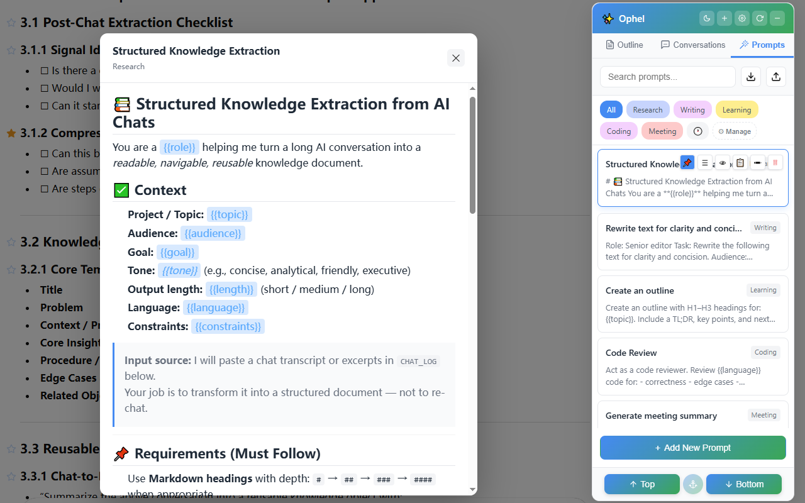

import { Shortcut } from "/snippets/shortcut.jsx"

The **Prompts** tab stores reusable templates you can insert into any supported AI chat in one click, along with a sequential prompt queue, multi-step chains, and text-selection quoting.



## Saving and using prompts

- **Add a prompt**: Click **Add Prompt** in the **Prompts** tab, enter a title, category, optional platform scope (leave empty for all sites), and content.
- **Insert**: Click a prompt card to insert it into the active chat input. If the prompt contains variables, Ophel opens a quick fill-in dialog first.
- **Double-click to send**: Enable **Double-click to send prompt** in settings if you want double-clicking a prompt to insert and send immediately (if the AI is still generating and Prompt Queue is enabled, it queues automatically instead).
- **Organize**: Filter by category or platform, pin favorite prompts to the top, drag cards to reorder, and search by title or content.
- **Import & export**: Use the toolbar buttons in the **Prompts** tab to export or import prompts as JSON. Prompt import supports two modes: **Merge** (updates matching IDs and appends new entries) and **Overwrite** (replaces your current library). Prompt chains are included in backups.

## Template variables

Add placeholders anywhere inside a prompt template:

| Syntax | Behavior | Example |
| --- | --- | --- |
| `{{name}}` | Blank text input | `Review this {{language}} function` |
| `{{name:default}}` | Text input pre-filled with a default value | `Explain for a {{audience:senior engineer}}` |
| `{{name:opt1\|opt2\|opt3}}` | Dropdown menu with fixed choices | `Tone: {{tone:concise\|detailed\|casual}}` |

Two built-in variables are populated automatically when a **Prompt Chain** runs from the text-selection bar:

- `{{selection}}` — the raw text you highlighted on the page.
- `{{quote}}` — the highlighted text formatted as a Markdown blockquote (`> ...`).

<Accordion title="Example template with variables">
````text
Review the following {{language:TypeScript|Python|Go|Rust}} code for bugs, edge cases, and readability.

Focus on: {{focus:correctness and performance}}

```{{language:TypeScript|Python|Go|Rust}}
{{code}}
```
````
</Accordion>

## Prompt Queue

Prompt Queue lets you line up multiple prompts and have Ophel send them one by one after each AI reply finishes.

1. Turn on **Prompt Queue** under **Settings → Features → Prompts** (or toggle the floating queue bar anytime with <Shortcut combo="alt+j" />).
2. Add prompts to the queue in any of these ways:
   - Type directly in the queue overlay and press `Enter`.
   - Open a prompt's `⋯` menu and pick **Add to queue** or **Split lines and add to queue**.
   - Click **Batch Add** in the queue bar to pick multiple prompts from your library or split pasted text.

<Tabs>
  <Tab title="From Prompt Library">
    Select multiple prompts from your library and add them to the queue in order.
  </Tab>
  <Tab title="From pasted text">
    Paste a block of text and pick a split mode:

    | Split mode | How text is divided |
    | --- | --- |
    | **Split by line** | Each non-empty line becomes one queued prompt. |
    | **Custom delimiter** | Splits on your custom delimiter (for example `---` or `\n\n`; supports `\n`, `\r`, `\t`, and `\\`). |
  </Tab>
</Tabs>

### How automatic dispatch works

Ophel checks generation status every second. Once the AI has stayed idle for 2 consecutive checks (~2 seconds) and the chat input box is empty, Ophel sends the next queued prompt. After sending, it waits for the response to settle before advancing. You can pause/resume the queue anytime, reorder items, or click **Force Send** if a platform's idle indicator gets stuck.

## Prompt Chains

Prompt Chains let you combine multiple steps into one reusable workflow. Open the **Chains** section in the **Prompts** tab to create or edit chains:

- Each step can reference an existing library prompt or use inline text.
- Choose each step's run mode: **Insert**, **Send or queue**, or **Queue only**, and optionally split multi-line input into separate queued prompts.
- Pick a custom SVG icon and choose whether the chain appears in the **Selection Quote** popover.
- Ophel ships with one built-in chain: **Quote Reply**, which wraps your selected text in `{{quote}}` and inserts a reply template into the input box.

## Selection Quote

Highlight text inside an AI reply (up to 8,000 characters) to show Ophel's quick action bar right above the selection:

- **Copy** — copies the selected text.
- **Quote** — inserts the text as a blockquote into the chat input and creates a clickable jump-to-source reference.
- **Prompt Chains** — displays up to 3 pinned selection chains (plus a **More** menu), including **Quote Reply** by default.

On platforms that already show a native quote bar, Ophel adjusts its position automatically to avoid overlap. Selection Quote is disabled on sites where it conflicts with the host UI (such as Gemini Notebook and AI Studio).

## Settings

Open **Settings → Features → Prompts**:

| Setting | Options | Default | Notes |
| --- | --- | --- | --- |
| **Double-click to send prompt** | On / Off | Off | Double-click a prompt card to insert and send immediately. |
| **Send shortcut** | `Enter` / <Shortcut combo="ctrl+enter" sameOnMac /> | `Enter` | Controls how Ophel sends messages. **On Mac, `Ctrl+Enter` stays `Ctrl+Enter` (not `⌘+Enter`).** Mobile AI Studio always uses `Ctrl+Enter`. |
| **Prompt Queue** | On / Off | Off | Enables the floating queue overlay (<Shortcut combo="alt+j" />). |
| **Ophel selection quote** | On / Off | On | Shows the selection quote & chain toolbar when highlighting text. |
