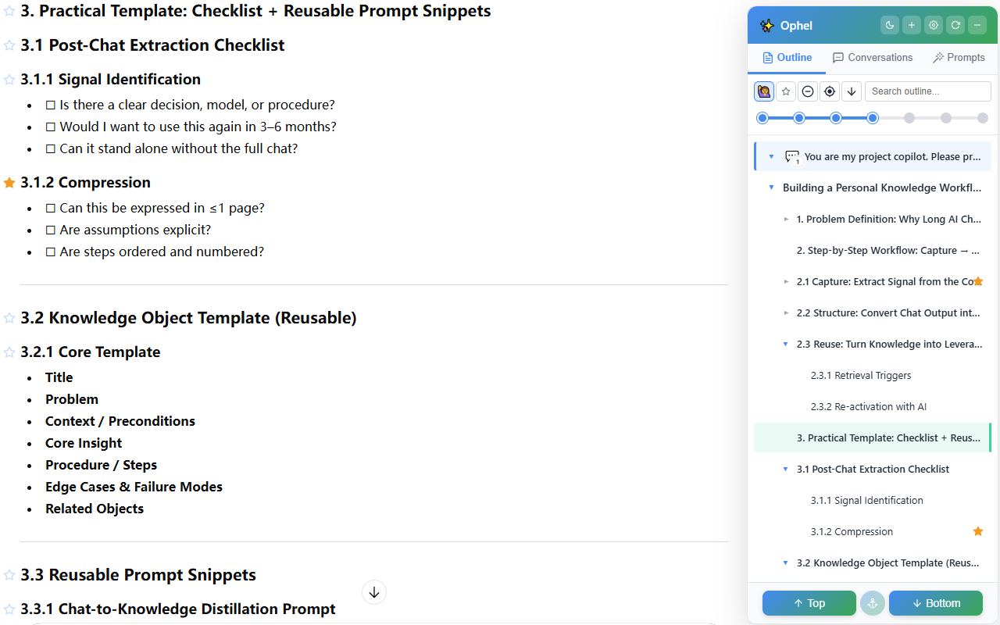
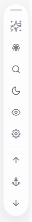
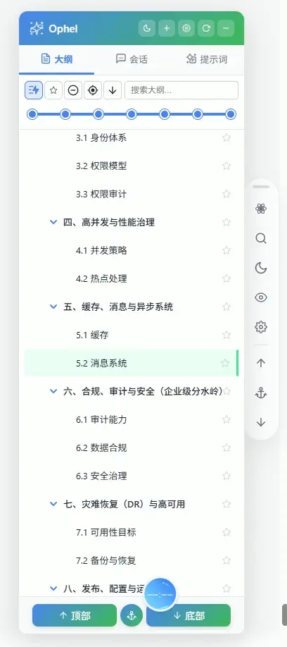
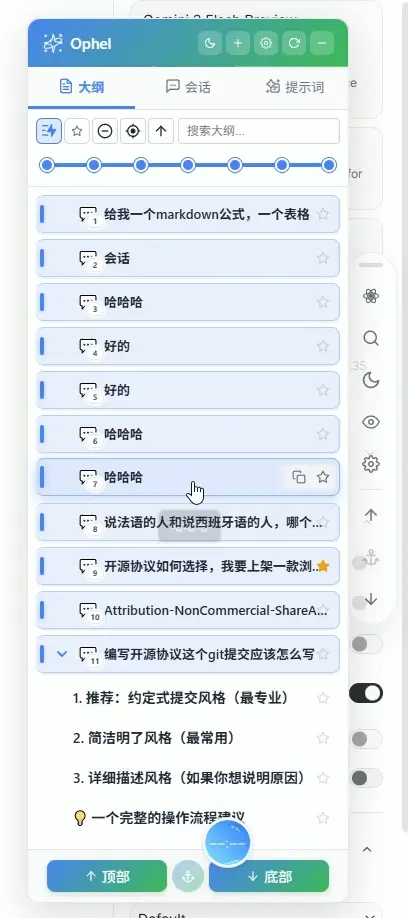

import { Icon } from "/snippets/icon.jsx"
import { Shortcut, ShortcutLegend } from "/snippets/shortcut.jsx"

When you open a supported AI platform, Ophel mounts a side panel inside your tab. On first install, accepting the local-use disclaimer starts a 4-step spotlight tour that walks you through **Outline**, **Chats**, **Prompts**, and **Settings**.

<Note>
On touch screens and narrow viewports (`≤ 767px`), the panel switches to a slide-over drawer with a backdrop. Floating vs. Edge Snap mode applies to desktop layouts.
</Note>

<ShortcutLegend lang="en" />

## The three tabs

| Tab | Shortcut | What it does |
| --- | --- | --- |
| <Icon src="/images/icons/outline.svg" alt="Outline icon" /> **Outline** | <Shortcut combo="alt+1" /> | Live table of contents for your prompts and AI headings, plus bookmarks and search. |
| <Icon src="/images/icons/conversation.svg" alt="Chats icon" /> **Chats** | <Shortcut combo="alt+2" /> | Synced chats organized by folders, tags, and pins, with batch actions and export. |
| <Icon src="/images/icons/prompt.svg" alt="Prompts icon" /> **Prompts** | <Shortcut combo="alt+3" /> | Reusable prompt templates, variable fill-in, prompt chains, and queue triggers. |

- **Reorder or hide tabs**: Drag tabs directly in the panel tab bar, or configure order and visibility under **Settings → General → Tab Order**. At least one tab must remain enabled. When only one tab is visible, the tab bar hides automatically to save space.
- **Sites without chat lists**: Platforms that do not expose a sidebar chat list (Gemini Notebook, ChatGLM, ima, Qianwen, Z.ai, and current Site Packs) hide the **Chats** tab automatically.

## Panel header

The top bar of the panel gives you quick access to window controls:

| Area / Button | Action |
| --- | --- |
| <Icon src="/images/icons/sparkle.svg" alt="Ophel icon" /> **Ophel title (left)** | Click—or hover for **350 ms**—to view release notes for the current version. Shows an unread dot after an update. |
| <Icon src="/images/icons/drag.svg" alt="Drag icon" /> **Header blank area** | Drag to move the panel. **Double-click** to toggle between **Floating** and **Edge Snap** mode (desktop only). Hold for **450 ms** to see the drag & pass-through click hint. |
| <Icon src="/images/icons/snap-to-edge.svg" alt="Edge Snap icon" /><Icon src="/images/icons/floating-mode.svg" alt="Floating mode icon" /> **Mode toggle** | Switch between **Floating** and **Edge Snap** mode (<Shortcut combo="alt+m" />). Shows the Edge Snap icon in Floating mode and the Floating icon in Edge Snap mode. |
| <Icon src="/images/icons/theme-dark.svg" alt="Dark theme icon" /><Icon src="/images/icons/theme-light.svg" alt="Light theme icon" /> **Theme toggle** | Switch between light and dark themes (<Shortcut combo="alt+d" />). Displays the moon icon in light mode and the sun icon in dark mode. |
| <Icon src="/images/icons/new-tab.svg" alt="New tab icon" /> **New tab** | Opens the current platform's homepage in a new tab. Only appears when **Open New Chat in New Tab** is enabled in **Settings → Features → Tab Settings**. |
| <Icon src="/images/icons/settings.svg" alt="Settings icon" /> **Settings** | Open the Ophel settings modal (<Shortcut combo="alt+," />). |
| <Icon src="/images/icons/minimize.svg" alt="Collapse icon" /> **Collapse** | Collapse the panel into the floating quick buttons (<Shortcut combo="alt+p" />). |

### Panel footer

The bottom bar of the panel keeps three scroll-navigation actions always within reach:

- <Icon src="/images/icons/scroll-top.svg" alt="Scroll top icon" /> **Scroll to Top** (<Shortcut combo="alt+t" />) — jumps to the top and records an anchor.
- <Icon src="/images/icons/anchor.svg" alt="Anchor icon" /> **Return to Anchor** (<Shortcut combo="alt+z" />) — jumps back to your saved position (disabled until an anchor is recorded).
- <Icon src="/images/icons/scroll-bottom.svg" alt="Scroll bottom icon" /> **Scroll to Bottom** (<Shortcut combo="alt+b" />) — jumps to the bottom and records an anchor.

## Floating quick buttons

When the panel is collapsed (or whenever **Hide quick buttons when panel is open** is turned off), Ophel displays a floating column of quick buttons on screen.

- **Auto-collapse into a droplet**: After your pointer leaves the proximity area for **3 seconds** (or **4 seconds** after dragging, pressing, closing the panel, or closing the Toolbox menu; or **1.5 seconds** after leaving the browser window / switching tabs), the strip collapses into a single <Icon src="/images/icons/sparkle.svg" alt="Ophel droplet icon" /> Ophel droplet.
- **Proximity wake**: Move your cursor within the wake distance (default **150 px**, range `0–300 px`) to expand the strip. Setting distance to `0` disables proximity detection and requires hovering the droplet for **300 ms** instead.
- **Hover preview (temporary floating panel)**: Whenever the main panel is collapsed on desktop, hover the <Icon src="/images/icons/sparkle.svg" alt="Panel icon" /> **Panel** button—either directly on the collapsed droplet or inside the expanded quick buttons strip—for **300 ms** to open a temporary floating preview panel right beside the button without permanently expanding it. *(If proximity distance is set to `0` and the strip is collapsed into a droplet, wait **600 ms** total: 300 ms to wake the strip plus 300 ms to open the preview.)* Move away from both the button and preview panel for **250 ms** to dismiss it automatically (active menus, dialogs, or resizing pause auto-hide), or click the **Panel** button to expand and pin the panel normally.
- **Reposition**: Press and hold (**220 ms**, moving less than 6 px) to drag the floating strip anywhere on screen; its relative viewport position is saved.

Configure button order, visibility, opacity (`40%–100%`), proximity radius, and **Hide quick buttons when panel is open** (default **On**) under **Settings → General → Shortcuts**.

### Default quick buttons

| Button | Action | Default |
| --- | --- | --- |
| <Icon src="/images/icons/sparkle.svg" alt="Panel icon" /> **Panel** | Click to expand or collapse the main panel (<Shortcut combo="alt+p" />); hover when collapsed to open a temporary preview panel. Always enabled; shows an unread dot when release notes are new. | On *(required)* |
| <Icon src="/images/icons/tools.svg" alt="Toolbox icon" /> **Toolbox** | Open the quick toolbox popover menu | On |
| <Icon src="/images/icons/search.svg" alt="Search icon" /> **Global Search** | Open Global Search (<Shortcut combo="ctrl+k" />) | On |
| <Icon src="/images/icons/theme-dark.svg" alt="Dark theme icon" /><Icon src="/images/icons/theme-light.svg" alt="Light theme icon" /> **Theme** | Toggle light / dark theme (<Shortcut combo="alt+d" />) | On |
| <Icon src="/images/icons/eye.svg" alt="Zen mode icon" /><Icon src="/images/icons/eye-closed.svg" alt="Exit zen mode icon" /> **Zen Mode** | Toggle Zen Mode (<Shortcut combo="ctrl+shift+z" />); switches to the closed-eye icon while active | On |
| <Icon src="/images/icons/settings.svg" alt="Settings icon" /> **Settings** | Open Settings (<Shortcut combo="alt+," />) | On |
| <Icon src="/images/icons/scroll-top.svg" alt="Scroll top icon" /> **Scroll to Top** | Jump to the top of the chat and save an anchor (<Shortcut combo="alt+t" />) | On |
| <Icon src="/images/icons/anchor.svg" alt="Anchor icon" /> **Return to Anchor** | Jump back to your previous scroll position (<Shortcut combo="alt+z" />) | On |
| <Icon src="/images/icons/scroll-bottom.svg" alt="Scroll bottom icon" /> **Scroll to Bottom** | Jump to the bottom of the chat and save an anchor (<Shortcut combo="alt+b" />) | On |

### Toolbox menu

Customize which items appear in the Toolbox under **Settings → General → Toolbox** (all enabled by default):

| Item | Action |
| --- | --- |
| <Icon src="/images/icons/export.svg" alt="Export icon" /> **Export** | Open the chat export dialog (<Shortcut combo="ctrl+shift+e" />). |
| <Icon src="/images/icons/folder-move.svg" alt="Move icon" /> **Move** | Move the current chat into a folder. |
| <Icon src="/images/icons/tag.svg" alt="Tag icon" /> **Set Tag** | Add or remove tags on the current chat. |
| <Icon src="/images/icons/scroll-lock.svg" alt="Scroll lock icon" /> **Scroll Lock** | Prevent the page from auto-scrolling to the bottom during streaming (<Shortcut combo="alt+s" />). Hidden on minimal-mode sites like Gemini Notebook. |
| <Icon src="/images/icons/model-lock.svg" alt="Model lock icon" /> **Model Lock** | Toggle automatic model locking for the current site. |
| <Icon src="/images/icons/cleanup.svg" alt="Cleanup icon" /> **Cleanup** | Remove invalid ("ghost") bookmarks whose headings no longer exist. |
| <Icon src="/images/icons/settings.svg" alt="Settings icon" /> **Settings** | Open Settings (always visible; cannot be turned off). |

## Floating and Edge Snap modes

Switch between modes with the header mode button, by double-clicking the header bar, or by pressing <Shortcut combo="alt+m" />:

- **Floating (default)**: The panel stays visible on the left or right side of the page. Drag its inner edge to resize between **240 px** and **600 px**. When **Smart Avoidance** is enabled, the page shifts cleanly so the panel does not cover text.
- **Edge Snap**: Drag the panel near the left or right edge (within the snap threshold) to tuck it off-screen. Hover the edge handle (or screen edge when hidden) for **300 ms** to slide it back out; moving away tucks it back after **200 ms** (with an **800 ms** hold when crossing out the snapped edge on multi-monitor setups). On wide touch screens, Edge Snap shows a tappable side tab.

### Panel size and position settings

Find these controls under **Settings → General → Panel**:

| Setting | Range / Options | Default | Notes |
| --- | --- | --- | --- |
| **Panel Mode** | Floating / Edge Snap | Floating | Clicking this row in Edge Snap mode reveals **Edge trigger style** (`Handle` [default] or `Hidden`). |
| **Default Side** | Left / Right | Right | Side where the panel opens and docks. |
| **Panel Width** | 240–600 px | 320 px | Clicking this row in Floating mode reveals **Widen on hover (Beta)** (default **Off**) and **Hover width** (240–600 px, default **520 px**). Hover previews never trigger page avoidance. |
| **Panel Height** | 50–100 vh | 85 vh | Percentage of viewport height. |
| **Snap Threshold** | 0–400 px | 30 px | Shown in Edge Snap mode. Distance from the screen edge that triggers snapping. |
| **Default Margin** | 0–400 px | 0 px | Shown in Floating mode. Gap between the panel and screen edge. |

## Pass-through click mode (Ghost mode)

If the panel or floating buttons temporarily sit over a button or link you need to click, **hold <Shortcut combo="ctrl" /> alone for 0.2 seconds**. Ophel turns translucent and passes pointer events straight through to the underlying page. Release the key to restore normal interaction.

## Global Search quick access

Press <Shortcut combo="ctrl+k" /> (or click the search quick button) to jump across outlines, synced chats from any supported platform, prompts, and settings. You can also enable **Double Shift** in **Settings → Features → Global Search**.

Example queries: `type:prompts`, `folder:work`, `date:30d`. See [Global Search](/features/global-search) for the complete filter syntax.

## Extension toolbar popup

Click the Ophel icon in your browser toolbar (extension builds) to open the compact popup:

- Check whether the current site is active, disabled, or unsupported, and switch between multi-domain hosts (for example, Kimi `.com`/`.ai` or Doubao/Dola).
- Enable or disable Ophel for the current site, or start a new chat.
- Launch any supported site from the **Quick Access** grid (drag cards to reorder them).
- Click any of your **3 most recently used prompts** to copy it to your clipboard.

## Next steps

<CardGroup cols={2}>
  <Card title="Smart Outline" icon="/images/icons/outline.svg" href="/features/outline">
    Navigate long replies with headings, bookmarks, and anchors.
  </Card>
  <Card title="Chat Management" icon="/images/icons/conversation.svg" href="/features/conversations">
    Organize synced chats with folders, tags, and safe cleanup.
  </Card>
  <Card title="Prompt Library" icon="/images/icons/prompt.svg" href="/features/prompts">
    Create reusable templates, prompt queues, and chains.
  </Card>
  <Card title="Keyboard Shortcuts" icon="/images/icons/keyboard.svg" href="/customization/shortcuts">
    View and customize all 46 keyboard shortcuts.
  </Card>
</CardGroup>
