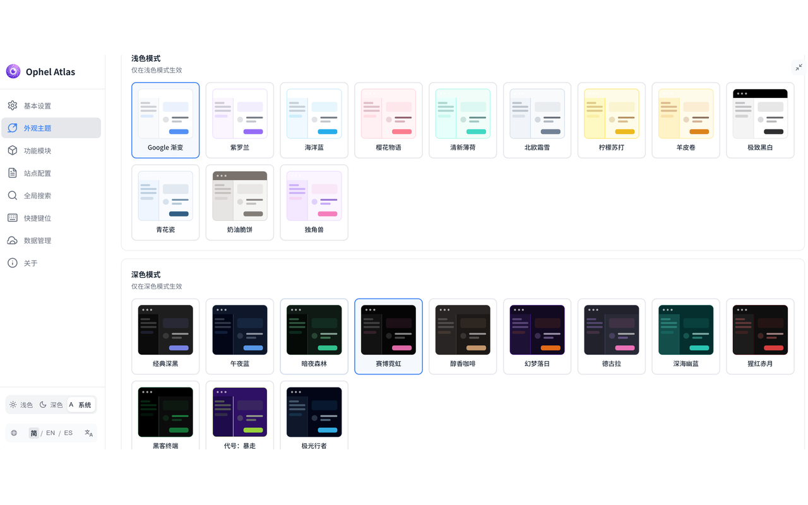

import { Shortcut } from "/snippets/shortcut.jsx"
import { ThemePresetGrid } from "/snippets/theme-preset-grid.jsx"

Ophel 内置 24 套预置主题（12 套浅色 + 12 套深色），支持按站点独立记忆主题、自动同步 AI 网站原生深浅色，并提供实时生效的自定义样式编辑器。



<Note>
请在任意受支持的 AI 页面内打开设置弹窗进入 **设置 → 外观主题**。如果直接打开独立的扩展选项页（当前页面无内容脚本挂载），侧栏会自动隐藏「外观主题」入口。
</Note>

## 浅色、深色与跟随系统

每个站点都会独立保存自己的明暗模式与所选预置主题。你可以通过以下方式随时切换：

- 按快捷键 <Shortcut combo="alt+d" />（触发从光标或按钮处向外扩散的过渡动画）。
- 点击面板标题栏或浮动快捷按钮中的主题图标。
- 在设置弹窗侧栏底部选择 **浅色 / 深色 / 跟随系统**。

### 同步原生页面主题

位于 **设置 → 外观主题** 顶部的 **同步原生页面主题**（默认 **开启**）：切换 Ophel 深浅色时，会同步把当前 AI 网站也切换到对应的浅色或深色模式。

- 支持 **15 个内置站点**（仅 **腾讯 ima** 不支持）。
- 支持配置了 `themeSync` 的社区适配包（Perplexity、WorkBuddy、LobeChat、阶跃 AI、知乎直答）。

## 24 套预置主题

打开 **设置 → 外观主题 → 预置主题**，点击任意卡片即可立即应用。浅色模式与深色模式可分别指定不同的预置主题。

<Tabs>
  <Tab title="浅色预置（12 套）">
    <ThemePresetGrid mode="light" locale="zh" />
  </Tab>
  <Tab title="深色预置（12 套）">
    <ThemePresetGrid mode="dark" locale="zh" />
  </Tab>
</Tabs>

## 自定义样式（Custom CSS）

进入 **设置 → 外观主题 → 自定义样式**，可以针对浅色或深色模式编写自己的 CSS 样式。保存后，它会像内置预置一样出现在主题列表中供各站点选用，且编辑后即时生效、无需刷新页面。

由于 Ophel 界面运行在 Shadow DOM 内，请在 `:host` 选择器下覆盖 `--gh-*` CSS 变量：

```css
:host {
  --gh-primary: #0f766e;
  --gh-bg: #fcfcfb;
  --gh-header-bg: linear-gradient(135deg, #0f766e 0%, #0284c7 100%);
  --gh-header-text: #ffffff;
  --gh-font-family: "Inter", "PingFang SC", system-ui, sans-serif;
}
```

### 常用 CSS 变量

| 变量名 | 控制区域 |
| --- | --- |
| `--gh-bg` | 面板与卡片主背景色 |
| `--gh-bg-secondary` | 次级区域背景色 |
| `--gh-text` | 主文字颜色 |
| `--gh-text-secondary` | 次要说明文字颜色 |
| `--gh-primary` | 强调色（按钮、选中态与高亮） |
| `--gh-primary-text` | 用于文字或图标的高可读强调色 |
| `--gh-border` | 边框与分割线颜色 |
| `--gh-shadow` | 面板阴影 |
| `--gh-header-bg` | 面板标题栏背景（支持纯色或渐变） |
| `--gh-header-text` | 面板标题栏文字与图标颜色 |
| `--gh-hover` | 列表项与按钮悬停背景色 |
| `--gh-danger` | 危险操作强调色 |
| `--gh-font-family` | Ophel 界面字体栈 |

<Tip>
`--gh-header-bg` 支持任意合法的 CSS `background` 写法，包括渐变色，例如 `linear-gradient(135deg, #1e40af 0%, #3b82f6 100%)`。
</Tip>
