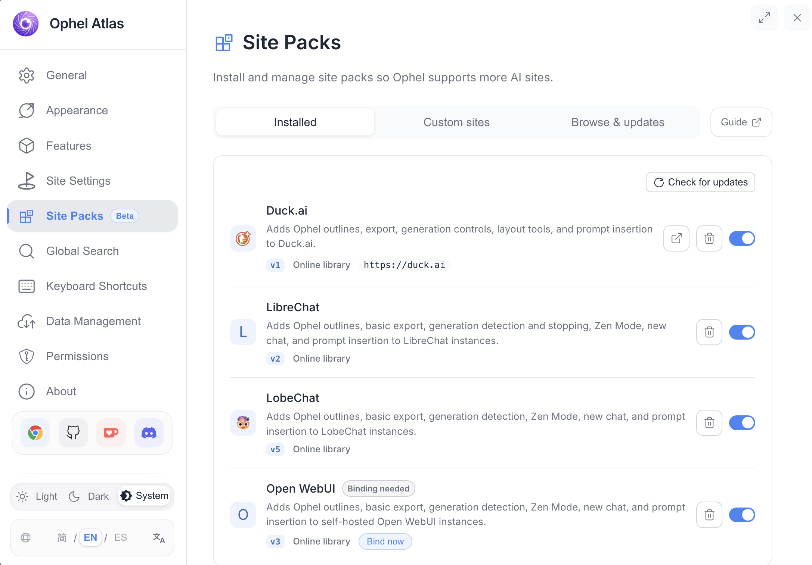

除了开箱即用的 16 个内置平台，你还可以通过 **适配中心（Site Packs）** 为更多 AI 网站开启 Ophel——比如 Perplexity、WorkBuddy、Notion AI、Manus、Open WebUI、LibreChat——不用等扩展整体发版。

所有内置站点开关、已安装适配包、自建站点地址和在线更新都集中在 **设置 → 适配中心** 管理。

## 内置站点 vs 站点适配包

| 对比维度 | 内置站点（16 个） | 站点适配包（社区库共 18 个） |
| --- | --- | --- |
| **启用方式** | 安装即用（仅 Gemini Enterprise 新用户默认停用） | 在 **获取与更新** 一键安装，或从本地导入 JSON 文件 |
| **功能深度** | 完整定制适配器（支持历史接口、多账号隔离、对话列表同步与站点专属设置） | 纯声明式配置，覆盖大纲、基础导出、提示词插入、宽屏、禅/净化模式、生成检测、主题同步等 |
| **自部署服务** | 固定官方域名 | 支持绑定任意精确的 `http://` 或 `https://` 地址（含局域网自建服务） |
| **更新方式** | 随 Ophel 扩展更新（支持远程选择器热修补丁） | 从签名在线适配库自动更新（每 24 小时检查一次） |

<Note>
站点适配包是纯 JSON 配置，不能包含任何 JavaScript 代码，也不能覆盖正在启用的内置站点（如果你先在「内置站点」里停用某内置平台，则允许用适配包接管）。
</Note>

## 适配中心的四个标签页

打开 **设置 → 适配中心**，顶部有四个标签页（右上角另提供 **使用指南** 按钮）：

1. **内置站点**：一键启用或停用 16 个内置平台，并快捷跳转对应站点设置。
2. **已安装**：查看、启停、更新或卸载已安装的适配包。
3. **自定义站点**：为已安装的适配包绑定你自己部署的站点地址（例如 `https://chat.company.internal` 或 `http://192.168.1.10:3000`）。
4. **获取与更新**：搜索并安装在线适配库中的适配包、从本地导入 JSON 文件、手动检查更新，以及底部默认折叠的 **内置配置补丁**（用于调试内置站点热修补丁）。

## 社区在线适配库清单

当前社区适配库共收录 **18 个站点适配包**（14 个自带默认域名 + 4 个纯自部署应用）：

### 开箱即用站点（14 个）

| 适配包 | 默认匹配域名 | 主要支持能力 |
| --- | --- | --- |
| **Perplexity** | `www.perplexity.ai` | 大纲、导出、提示词、宽屏、禅模式、主题同步 |
| **WorkBuddy** | `www.workbuddy.cn/app`、`www.workbuddy.ai/app` | 大纲、导出、提示词、生成检测、面板避让、宽屏、禅/净化模式、主题同步 |
| **Notion AI** | `app.notion.com/ai*`、`app.notion.com/chat*` | 大纲、导出、提示词、宽屏、禅模式 |
| **Manus** | `manus.im` | 大纲、导出、提示词、宽屏、禅/净化模式、Mermaid 渲染 |
| **Genspark** | `www.genspark.ai` | 大纲、导出、提示词、生成检测、宽屏、禅/净化模式 |
| **Duck.ai** | `duck.ai` | 大纲、导出、提示词、生成检测、宽屏、禅模式 |
| **Proton Lumo** | `lumo.proton.me` | 大纲、导出、提示词、生成检测、宽屏、禅/净化模式 |
| **LobeChat** | `app.lobehub.com` *（也支持绑定自建域名）* | 大纲、导出、提示词、生成检测、面板避让、禅模式、主题同步 |
| **阶跃 AI（StepFun）** | `chat.stepfun.com` | 大纲、导出、提示词、生成检测、面板避让、宽屏、禅模式、主题同步 |
| **LongCat AI** | `longcat.chat` | 大纲、导出、提示词、生成检测、宽屏、禅模式 |
| **百度文心** | `wenxin.baidu.com` | 大纲、导出、提示词、宽屏、禅模式 |
| **知乎直答** | `zhida.zhihu.com` | 大纲、导出、提示词、宽屏、禅模式、主题同步 |
| **OpenCode 分享页** | `opncd.ai` | 只读分享页：大纲、导出、Mermaid 渲染 |
| **Muse** *（需要 Ophel v1.3.7+）* | `muse.ai` | 精简增强模式：大纲、导出、提示词、宽屏、禅模式（主对话与旁聊） |

### 自部署应用（4 个 — 安装后绑定你的站点地址）

| 适配包 | 主要支持能力 |
| --- | --- |
| **Open WebUI** | 大纲、导出、提示词、生成检测、禅模式 |
| **LibreChat** | 大纲、导出、提示词、生成检测、禅模式 |
| **NextChat** | 大纲、导出、提示词、禅模式 |
| **DeepSeek Harness** | 大纲、导出、提示词、生成检测、宽屏、禅模式、阅读历史 |

## 安全保障

- **不执行远程代码**：适配包只是受约束的 JSON 配置文件（单文件上限 64 KiB），无法夹带脚本。
- **签名与完整性校验**：在线适配库索引使用 Ed25519 数字签名，每个适配包下载后都会校验 SHA-256 摘要；校验失败时会自动保留你原本能正常使用的旧版本。
- **按站授权**：扩展端只会为该适配包实际需要的站点域名申请权限，卸载后自动回收不再使用的托管域名权限。

## 下一步

<CardGroup cols={2}>
  <Card title="安装与管理" icon="download" href="/zh/enhancements/site-extensions/installation">
    查看在线安装、本地导入、绑定自部署站点地址与权限管理的详细步骤。
  </Card>
  <Card title="常见问题" icon="circle-question" href="/zh/enhancements/site-extensions/faq">
    解答自动更新、数据隔离、权限以及网站改版失效的排查办法。
  </Card>
  <Card title="能力参考（作者向）" icon="list-check" href="/zh/enhancements/site-extensions/capabilities">
    查看全部 15 项适配包能力标识与配置约束。
  </Card>
  <Card title="编写适配包（作者向）" icon="code" href="/zh/enhancements/site-extensions/authoring">
    编写声明式 JSON 适配包、本地导入验证并向社区适配库提交。
  </Card>
</CardGroup>
