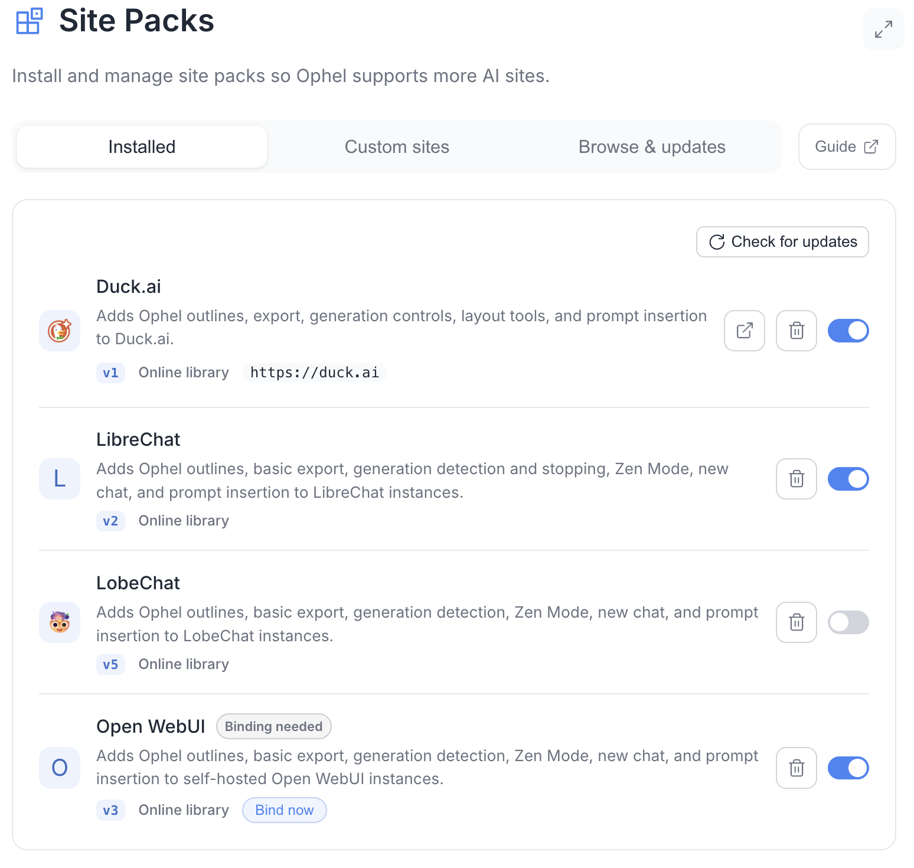
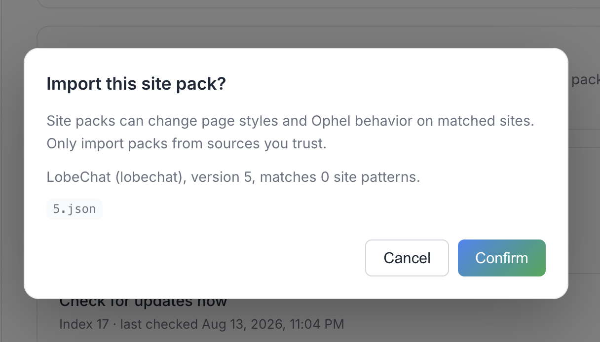
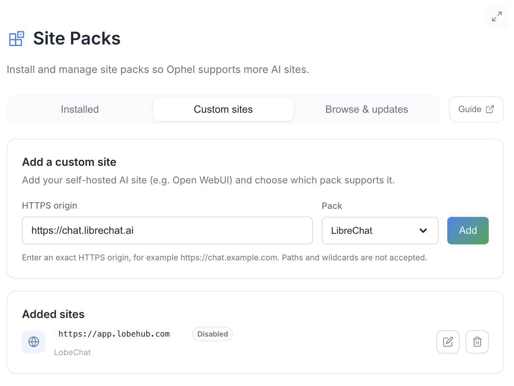
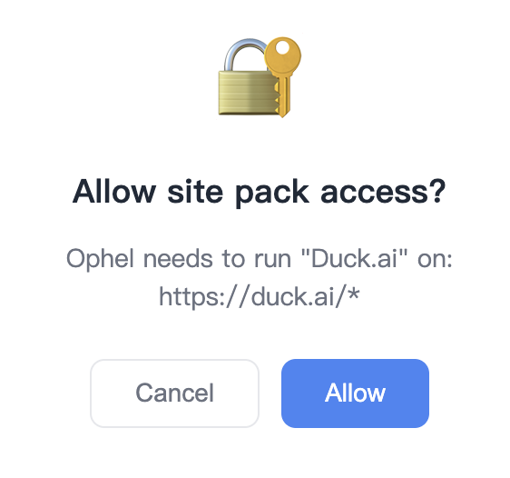

所有站点适配包的安装、自建地址绑定、更新与卸载都在 **设置 → 适配中心** 完成。

## 从在线适配库安装

<Steps>
  <Step title="打开「获取与更新」">
    进入 **设置 → 适配中心 → 获取与更新**。
  </Step>
  <Step title="搜索并安装">
    在在线适配库中找到目标站点，点击 **安装**。
  </Step>
  <Step title="同意站点访问权限（扩展版）">
    浏览器会弹出授权提示，仅请求该站点对应域名的访问权限。点击允许即可生效；如果拒绝，系统会自动回滚安装。
  </Step>
  <Step title="打开网站使用">
    点击 **打开站点**（或刷新已打开的标签页），即可看到 Ophel 面板。
  </Step>
</Steps>

<Note>
默认情况下，在线适配库优先从 jsDelivr（`cdn.jsdelivr.net/gh/urzeye/ophel@registry-dist/index.json`）拉取签名索引，失败时自动回退 GitHub 源（`raw.githubusercontent.com/urzeye/ophel/registry-dist/index.json`）；开启自动更新时每 **24 小时**检查一次。
</Note>

## 从本地文件导入适配包

如果你自己编写了适配包，或收到了他人分享的 `.json` 文件，可以本地导入：

<Steps>
  <Step title="选择本地导入">
    进入 **设置 → 适配中心 → 获取与更新**，点击 **从文件安装适配包**。
  </Step>
  <Step title="查看校验摘要">
    Ophel 会校验文件格式、体积、选择器与匹配规则，并展示适配包名称、版本和匹配的站点数量。
  </Step>
  <Step title="确认并授权">
    确认导入，扩展版按提示允许对应站点权限即可生效。
  </Step>
</Steps>

<Warning>
本地导入的适配包不经过在线签名校验，也**不会**自动更新。请只导入你信任来源的文件。
</Warning>

## 为自部署应用绑定站点地址

如果你安装的是纯自部署适配包（如 **Open WebUI**、**LibreChat**、**NextChat**、**DeepSeek Harness**）——或者自己架设了 **LobeChat**——需要把你的访问地址绑定到对应适配包：

<Steps>
  <Step title="先安装对应适配包">
    在 **获取与更新** 安装目标适配包（未绑定地址前会显示 **自部署 / 待绑定站点地址** 徽章）。
  </Step>
  <Step title="进入「自定义站点」">
    切换到 **设置 → 适配中心 → 自定义站点**（或在适配包卡片上直接点 **去绑定**）。
  </Step>
  <Step title="填写精确的站点地址">
    选择对应适配包并填入站点根地址——**同时支持 `https://` 和 `http://`**（如 `https://ai.example.com` 或内网 `http://192.168.1.10:3000`），不要附加路径或通配符。
  </Step>
  <Step title="保存并授权">
    保存绑定后，在浏览器弹窗中允许访问该域名即可。
  </Step>
</Steps>

- **不同地址的数据完全隔离**：同一个适配包如果分别绑定了公司和家里的两个 Open WebUI 地址，各自的站点设置、书签与阅读记录互不干扰。

## 不同平台的权限机制

- **Chrome / Edge / Firefox 扩展**：只申请该适配包实际需要的域名权限并动态注册脚本；当你停用、卸载适配包或删除自定义地址后，不再被引用的托管域名权限会自动回收。
- **从备份恢复后**：恢复的适配包会保留原有配置，并在页面顶部提供 **重新授权已恢复的适配包** 区块，一键重新授权即可恢复运行。
- **Safari（macOS 实验版）**：Safari 不支持弹窗动态授权，网站访问权限需在 **Safari → 设置 → 扩展 → Ophel Atlas** 中手动勾选，界面会给出具体引导。
- **油猴脚本**：默认声明了广义匹配并在脚本内部按白名单过滤，不弹浏览器权限窗。如果你手动改窄了油猴管理器中的 `@match` 规则，保存自定义站点后页面会列出尚未覆盖的域名，提醒你手动补充 `@match`。

## 更新、停用与卸载

- **检查更新**：在 **已安装** 或 **获取与更新** 中点击 **检查更新**，都会刷新整个在线适配库并更新所有可升级的在线适配包。
- **停用**：在 **已安装** 列表关闭开关，即可暂停在该站点运行，保留所有配置与绑定。
- **卸载**：移除适配包及其自定义地址绑定，但会**保留**你的站点设置和本地数据，日后重装无需重新配置。

## 状态徽章说明

| 徽章 | 含义 |
| --- | --- |
| **可用** | 已安装且正常启用。 |
| **已停用** | 已安装但手动暂停运行。 |
| **自部署** / **待绑定站点地址** | 该适配包没有固定官网域名，需到 **自定义站点** 绑定你的地址后才会生效。 |
| **不兼容** | 当前 Ophel 版本过低（会提示「需要 Ophel X.Y.Z 或更高版本」），升级 Ophel 后即可启用。 |
| **适配库中已移除** | 在线库已下架该包，但你本机已安装的版本仍可继续使用，直到你手动卸载。 |
| **在线适配库** / **本地导入** | 标明该包来自在线自动更新库还是本地手动导入。 |
