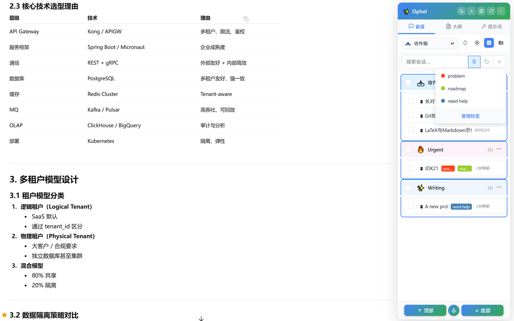

import { Icon } from "/snippets/icon.jsx"
import { Shortcut } from "/snippets/shortcut.jsx"

**对话** 标签页在 AI 平台原有历史列表之上，提供单层项目文件夹、多标签筛选、置顶、搜索与批量操作。

<Note>
**支持范围**：**对话** 标签页仅在提供侧栏历史列表的 **11 个内置平台** 显示：ChatGPT、Gemini、Gemini Enterprise、AI Studio、Claude、Grok、DeepSeek、豆包 / Dola、Kimi、Qwen Studio 与腾讯元宝。其余 5 个内置平台（Gemini Notebook、智谱清言、腾讯 ima、通义千问、Z.ai）以及当前社区适配包会自动隐藏该标签并跳过同步。
</Note>

## 对话如何同步与安全清理

Ophel 只从当前站点读取对话标题与链接（Claude、Grok、Qwen Studio 走接口分页同步，其余站点扫描侧栏），并在本地保存你的文件夹、标签与置顶等整理信息；聊天正文始终留在 AI 平台本身。

- **有上限、可随时停止的同步**：首次和手动全量同步单次最长运行 120 秒（侧栏滚动上限 90 秒），边拉取边落盘，面板上方会显示进度条和 **停止** 按钮。一旦你操作页面原生侧栏或切换页面，同步会立刻交还控制权。
- **防误删的缺失对话审阅与撤销**：如果同步中断、失败或返回空列表，Ophel 绝不会静默删掉你整理好的文件夹、标签和置顶。只有当完整手动同步成功且结果非空时，才会把远端找不到的本地记录汇总到 **缺失对话审阅** 弹窗：
  - 弹窗内支持搜索、全选/反选，也可直接点击打开原对话链接核对。
  - 在审阅弹窗中清理 **只会删掉 Ophel 本地记录，绝不会删除 AI 平台上的原对话**。
  - 清理完成后底部会弹出 **5 秒撤销倒计时**（鼠标悬停或切离标签页时自动暂停），可随时一键撤回。
- **页内平滑切换**：在内置站点点击对话列表时优先页内无刷新切换，避免整页重新加载；ChatGPT 的项目对话与 GPTs 对话也会保留原始链接路径。

## 多账号、多工作空间与多域名隔离

切换账号或空间时，Ophel 会自动隔离本地对话列表，防止记录串台：

- **账号与工作空间隔离**：ChatGPT 按个人/团队工作空间隔离；Claude 按账号与组织隔离；Grok、AI Studio、Gemini、DeepSeek、Kimi、Qwen Studio、腾讯元宝按当前登录账号隔离。页面尚未解析出账号身份时，Ophel 会等待就绪再同步。
- **多域名本地数据隔离**：共用同一适配器的多域名站点（**豆包** `doubao.com` 与 **Dola** `dola.com`、**Kimi** `.com` 与 `.ai`、**Z.ai** `chat.z.ai` 与 `zchat.z.ai`）共享设置项，但本地对话列表、书签和阅读历史按域名独立保存。

## 文件夹、标签与置顶

- <Icon src="/images/icons/folder.svg" alt="文件夹图标" /> **文件夹（单层平级）**：每条对话归属一个文件夹（默认归入固定的 **收件箱**）。点击 <Icon src="/images/icons/folder-plus.svg" alt="新建文件夹图标" /> 新建文件夹，可自定义名称与 64 种 Emoji 图标、拖拽调整顺序，或直接把对话拖入文件夹（也可通过对话行 <Icon src="/images/icons/more-horizontal.svg" alt="更多菜单图标" /> 菜单或 <Icon src="/images/icons/tools.svg" alt="工具箱图标" /> **工具箱 → <Icon src="/images/icons/folder-move.svg" alt="移动图标" /> 移动**）。列表左上角的文件夹选择器决定新同步进来的对话默认放进哪个文件夹。
- <Icon src="/images/icons/tag.svg" alt="标签图标" /> **多标签**：可为同一条对话添加多个彩色标签（内置 30 种配色）并按标签筛选。
- <Icon src="/images/icons/pin.svg" alt="置顶图标" /> **置顶**：把常用对话置顶到文件夹顶部，并可按需同步取消置顶状态。

## 批量操作

点击工具栏的 <Icon src="/images/icons/batch.svg" alt="批量操作图标" /> 批量操作按钮即可多选对话（支持按住 `Shift` 范围连选或整文件夹全选）：

- 批量 <Icon src="/images/icons/pin.svg" alt="置顶图标" /> **置顶/取消置顶**、<Icon src="/images/icons/folder-move.svg" alt="移动图标" /> **移动到文件夹**、<Icon src="/images/icons/tag.svg" alt="标签图标" /> **增删标签**、<Icon src="/images/icons/delete.svg" alt="删除图标" /> **删除** 与 <Icon src="/images/icons/clear.svg" alt="退出图标" /> **退出**。
- <Icon src="/images/icons/export.svg" alt="导出图标" /> **导出**：当**恰好选中 1 条对话**时可点击导出（平时也可从对话行右侧 <Icon src="/images/icons/more-horizontal.svg" alt="更多菜单图标" /> 菜单导出，或按 <Shortcut combo="ctrl+shift+e" /> 导出当前打开的对话）。详见[导出对话](/zh/features/export)。

## 快捷键

| 操作 | 默认快捷键 |
| --- | --- |
| <Icon src="/images/icons/edit.svg" alt="新对话图标" /> 新建对话 | <Shortcut combo="ctrl+shift+o" /> |
| <Icon src="/images/icons/refresh.svg" alt="刷新图标" /> 刷新对话列表 | <Shortcut combo="alt+shift+r" /> |
| <Icon src="/images/icons/locate.svg" alt="定位图标" /> 定位当前对话 | <Shortcut combo="alt+shift+l" /> |
| <Icon src="/images/icons/chevron-up.svg" alt="上一个图标" /><Icon src="/images/icons/chevron-down.svg" alt="下一个图标" /> 上一个 / 下一个对话 | <Shortcut combo="alt+[" /> / <Shortcut combo="alt+]" /> |
| <Icon src="/images/icons/export.svg" alt="导出图标" /> 导出当前对话 | <Shortcut combo="ctrl+shift+e" /> |
| <Icon src="/images/icons/copy.svg" alt="复制图标" /> 复制最新 AI 回复 | <Shortcut combo="ctrl+shift+c" /> |

## 设置项

路径：**设置 → 功能模块 → 对话**

| 设置项 | 默认值 | 说明 |
| --- | --- | --- |
| **文件夹彩虹色** | 开启 | 为不同文件夹分配柔和的区分底色。 |
| **同步取消置顶状态** | 关闭 | 当站点上取消置顶时，同步取消 Ophel 中的置顶状态。 |
| **删除对话时同步删除站点上的对话** | 开启 | 在 Ophel 中删除对话时，同时删除该 AI 平台上的原对话。 |

<Warning>
**删除对话时同步删除站点上的对话** 默认为 **开启**。在支持远端删除的平台上，从对话列表或批量操作中删除对话会**永久删除原平台上的聊天记录且无法恢复**。如果你只想清理 Ophel 本地目录而不动原站点数据，请务必先关闭此项。（「缺失对话审阅」中的清理始终只删本地记录，不受此项影响。）
</Warning>
