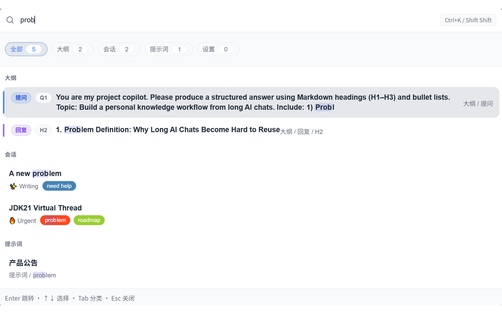

import { Icon } from "/snippets/icon.jsx"
import { Shortcut } from "/snippets/shortcut.jsx"

全局搜索把当前对话的大纲、所有平台已同步的对话、提示词库和 Ophel 全部设置项汇总到一个弹窗里，键盘即可完成定位与执行。

## 如何打开全局搜索

- 按快捷键 <Shortcut combo="ctrl+k" />（可在 **设置 → 快捷键位** 修改）。
- 点击浮动快捷按钮中的 <Icon src="/images/icons/search.svg" alt="搜索图标" /> **全局搜索** 图标。
- **双击 `Shift`**（可选，默认关闭）：在设置中开启 **双击 Shift 打开全局搜索** 后，在受支持的 AI 页面标签页内，无论焦点在输入框中还是页面任意区域（无需先展开面板），在 360 毫秒内连按两次 `Shift` 即可唤起。两次之间若按下其他键会自动中断，不会干扰正常打字。

## 搜索范围

在弹窗中按 `Tab` / `Shift+Tab` 或点击顶部分类标签即可切换范围：

| 分类 | 搜索内容 | 回车后的行为 |
| --- | --- | --- |
| <Icon src="/images/icons/search.svg" alt="全部图标" /> **全部** | 汇总各类别最匹配的结果 | 执行对应条目的默认操作。 |
| <Icon src="/images/icons/outline.svg" alt="大纲图标" /> **大纲** | 当前对话的提问与各级标题 | 直接滚动定位到对应节点。 |
| <Icon src="/images/icons/conversation.svg" alt="对话图标" /> **对话** | 当前平台及 **其他已支持平台** 的历史对话（跨站结果会带站点图标） | 当前站点直接切换；其他站点在新标签页打开。 |
| <Icon src="/images/icons/prompt.svg" alt="提示词图标" /> **提示词** | 提示词标题、正文、分类与标签 | 按回车行为设置直接插入/弹窗填变量，或定位到提示词面板。 |
| <Icon src="/images/icons/settings.svg" alt="设置图标" /> **设置** | 所有设置页面与具体开关（兼容旧名字别名搜索） | 直接打开对应设置页并滚动高亮到该选项。 |
| <Icon src="/images/icons/features.svg" alt="技巧图标" /> **技巧** | 内置功能小技巧与快捷键说明 | 直接在弹窗里查阅。 |

<Tip>
鼠标悬停在某条提示词结果上约 0.5 秒（或方向键选中停留约 0.7 秒），侧边会弹出完整正文预览，方便确认后再插入。
</Tip>

## 过滤语法

你可以把关键词和 6 种过滤运算符组合使用。输入时会自动弹出语法补全建议、展示过滤胶囊（最多显示 4 个），并在拼写有误或规则冲突时给出提示；点击搜索框里的 `?` 可随时查看语法卡片。

| 运算符 | 适用范围 | 可填值 | 示例 |
| --- | --- | --- | --- |
| `type:` | 全部 | `outline`、`conversations`、`prompts`、`settings` | `type:prompts 代码审查` |
| `folder:` | 对话 | 文件夹名称（模糊匹配，支持 `inbox` / 收件箱） | `folder:工作 架构` |
| `tag:` | 对话、提示词 | 标签名称（支持写多个，表示同时满足） | `tag:sql tag:线上` |
| `is:` | 对话 | `pinned`（已置顶）、`unpinned`（未置顶） | `is:pinned 周报` |
| `level:` | 大纲 | `0`–`6`（`0` 表示用户提问，`1`–`6` 对应 H1–H6） | `level:0 docker` |
| `date:` | 对话、提示词 | `Nd`（最近 N 天，如 `7d`、`30d`） | `date:7d 迁移` |

## 模糊搜索

默认使用精确子串匹配；开启 **启用模糊搜索** 后，即使漏字母或轻微拼写偏差也能命中结果。

## 设置项

路径：**设置 → 功能模块 → 全局搜索**

| 设置项 | 可选项 | 默认值 | 说明 |
| --- | --- | --- | --- |
| **启用全局搜索** | 开启 / 关闭 | 开启 | 全局搜索总开关。 |
| **双击 Shift 打开全局搜索** | 开启 / 关闭 | 关闭 | 在支持的 AI 标签页内快速连按两次 `Shift` 唤起搜索。 |
| **启用模糊搜索** | 开启 / 关闭 | 关闭 | 开启拼写容错与模糊匹配。 |
| **提示词回车行为** | 智能插入 / 仅定位 | 智能插入 | **智能插入**：直接插入输入框（含变量则弹填空框）；**仅定位**：切到提示词标签页并高亮该项。 |
