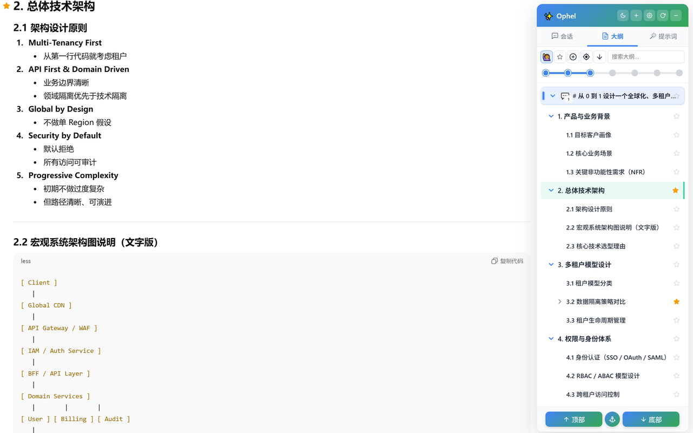

import { Icon } from "/snippets/icon.jsx"
import { Shortcut } from "/snippets/shortcut.jsx"

**大纲** 标签页会自动读取你的提问和 AI 回复中的 Markdown 标题（`H1`–`H6`），生成一棵实时更新的目录树。点击任意条目即可直接跳到对应位置。

## 大纲如何生成与展开

- **随回答实时更新**：AI 生成过程中自动刷新目录（默认每 **2 秒**一次）。
- **虚拟滚动自动补全**：在会卸载屏幕外消息的平台（如 DeepSeek、Claude、AI Studio、Grok、Qwen Studio），Ophel 会通过平台历史接口补全未渲染的历史节点，不用手动一路往上滚也能看到完整目录。
- **0–6 级层级滑块**：拖动工具栏上的深度滑块即可控制展开层级。`0` 级表示只看你的提问，`1`–`6` 级依次展开对应级别的标题。也可以点击单个节点折叠、按 <Shortcut combo="alt+e" /> 全部展开/折叠，或按 <Shortcut combo="alt+shift+1" /> 到 <Shortcut combo="alt+shift+6" /> 直接展开到指定层级。

## 文档大纲切换（多大纲源）

在自带右侧文档或产物栏的平台上，**大纲** 顶部会显示 <Icon src="/images/icons/outline-document.svg" alt="文档大纲图标" /> 数据源切换栏：

| 平台 | 可切换的大纲源 |
| --- | --- |
| <Icon src="/images/icons/gemini.png" alt="Gemini 图标" /> **Gemini** | 对话大纲 / Deep Research 报告 / Canvas 文档 |
| <Icon src="/images/icons/claude.svg" alt="Claude 图标" /> **Claude** | 对话大纲 / Artifact 文档面板 |
| <Icon src="/images/icons/gemini-notebook.png" alt="Gemini Notebook 图标" /> **Gemini Notebook** | 来源（Sources） / 对话（Chat） / Studio 产物与笔记 |

## 工具栏操作与快捷键

| 功能 | 快捷键 | 说明 |
| --- | --- | --- |
| <Icon src="/images/icons/search.svg" alt="搜索图标" /> **搜索大纲** | <Shortcut combo="alt+f" /> | 实时过滤目录条目，高亮关键词并显示匹配数。 |
| <Icon src="/images/icons/user-query.svg" alt="用户问题图标" /> **显示/隐藏用户问题** | <Shortcut combo="alt+q" /> | 切换目录中是否显示你发出的提问。 |
| <Icon src="/images/icons/user-query.svg" alt="只看用户问题图标" /> **只显示用户问题** | <Shortcut combo="alt+shift+q" /> | 直接切到 `0` 级，只保留每一轮提问。 |
| <Icon src="/images/icons/star.svg" alt="收藏图标" /> **显示用户收藏** | <Shortcut combo="alt+c" /> | 只看加了星标书签的节点（开启期间会禁用层级滑块）。 |
| <Icon src="/images/icons/expand-all.svg" alt="展开图标" /><Icon src="/images/icons/collapse-all.svg" alt="折叠图标" /> **展开/折叠全部** | <Shortcut combo="alt+e" /> | 一键展开或收起全部标题分支。 |
| <Icon src="/images/icons/locate.svg" alt="定位图标" /> **定位当前位置** | <Shortcut combo="alt+l" /> | 让大纲列表滚到你当前正在阅读的标题。 |
| <Icon src="/images/icons/refresh.svg" alt="刷新图标" /> **刷新大纲** | <Shortcut combo="alt+r" /> | 手动触发一次重新提取。 |
| <Icon src="/images/icons/arrow-up.svg" alt="上移图标" /><Icon src="/images/icons/arrow-down.svg" alt="下移图标" /> **上一个 / 下一个标题** | <Shortcut combo="alt+arrowup" /> / <Shortcut combo="alt+arrowdown" /> | 逐条在标题间前后跳转。 |
| <Icon src="/images/icons/export.svg" alt="导出图标" /> **导出对话** | <Shortcut combo="ctrl+shift+e" /> | 打开[导出对话](/zh/features/export)弹窗。 |

## 书签收藏

在长对话里遇到关键结论时，可以随时打星收藏：

- **两处收藏入口**：既可以点页面正文中标题或提问旁的 <Icon src="/images/icons/star.svg" alt="收藏图标" /> **页内收藏图标**，也可以点 **大纲面板内的收藏图标**。两者可分别设置为 **始终显示**（默认）、**悬停显示** 或 **隐藏**。
- **清理无效收藏**：如果重新生成或修改回答后原标题不再存在，对应书签会变成无效收藏。点击 <Icon src="/images/icons/tools.svg" alt="工具箱图标" /> **工具箱 → <Icon src="/images/icons/cleanup.svg" alt="清理图标" /> 清理无效收藏** 即可一键清理。

## 字数统计、单节复制与复制大纲

- **字数统计**：在大纲设置的高级选项中开启 **显示字数统计** 后，会在大纲条目上显示字数信息。
- **复制单节**：悬停在任意大纲条目上，点击 <Icon src="/images/icons/copy.svg" alt="复制图标" /> 复制按钮即可复制该节内容。
- **复制完整大纲**：点击工具栏的 <Icon src="/images/icons/copy-outline.svg" alt="复制大纲图标" /> 复制大纲按钮（或在导出弹窗中点「复制大纲」），可将整份目录复制为 Markdown。包含用户提问时，Ophel 会把提问设为一级标题 `#` 并将回复内标题按需顺延降级，确保复制后的文档层级清晰、不会错乱。

## 设置项

路径：**设置 → 功能模块 → 大纲**

| 设置项 | 可选项 | 默认值 | 所在位置 |
| --- | --- | --- | --- |
| **大纲跟随模式** | 跟随当前位置 / 跟随最新消息 / 手动控制 | 跟随当前位置 | 大纲设置卡 |
| **对话中自动更新大纲** | 开启 / 关闭 | 开启 | 大纲设置卡 → 底部 **高级选项** |
| **更新间隔（秒）** | 1–60 秒 | 2 秒 | 大纲设置卡 → 底部 **高级选项** |
| **显示字数统计** | 开启 / 关闭 | 关闭 | 大纲设置卡 → 底部 **高级选项** |
| **页内收藏图标** | 始终显示 / 悬停显示 / 隐藏 | 始终显示 | 收藏图标卡 |
| **面板收藏图标** | 始终显示 / 悬停显示 / 隐藏 | 始终显示 | 收藏图标卡 |
| **阻止自动滚动到底部** | 开启 / 关闭 | 关闭 | 滚动设置卡（临时切换也可按 <Shortcut combo="alt+s" /> 或在工具箱开关） |
