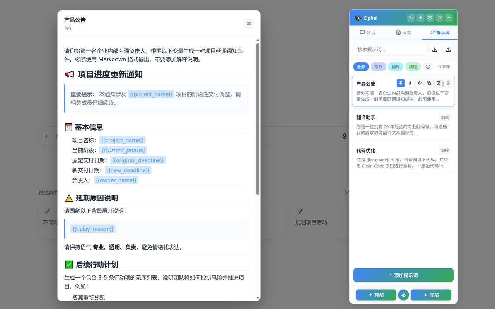

import { Icon } from "/snippets/icon.jsx"
import { Shortcut } from "/snippets/shortcut.jsx"

在 **提示词** 标签页中，你可以集中保存常用模板，一键插入任意支持的 AI 对话框，也可以用提示词队列、链式提示词和划词引用把重复操作串成流水线。



## 创建与使用提示词

- **新建**：点击 <Icon src="/images/icons/prompt.svg" alt="提示词图标" /> **添加提示词**，填写标题、分类、适用平台（留空表示所有平台可用）和正文。
- **一键插入**：单击任意提示词即可填入当前输入框；如果模板里带变量，会先弹出填空窗口。
- **双击直接发送**：在设置中开启「双击直接发送」后，双击提示词会插入并立即发送（如果 AI 正在回复且已开启提示词队列，会自动排进队列）。
- **整理与检索**：支持按分类或平台筛选、<Icon src="/images/icons/pin.svg" alt="置顶图标" /> 置顶常用模板，在 <Icon src="/images/icons/more-horizontal.svg" alt="更多菜单图标" /> 菜单中预览（<Icon src="/images/icons/eye.svg" alt="预览图标" />）、复制（<Icon src="/images/icons/copy.svg" alt="复制图标" />）、编辑（<Icon src="/images/icons/edit.svg" alt="编辑图标" />）或删除（<Icon src="/images/icons/delete.svg" alt="删除图标" />），并支持拖拽排序与 <Icon src="/images/icons/search.svg" alt="搜索图标" /> 关键词搜索。
- **导入与导出**：在提示词工具栏点击 <Icon src="/images/icons/import.svg" alt="导入图标" /> **导入** 或 <Icon src="/images/icons/export.svg" alt="导出图标" /> **导出** JSON 文件。导入支持两种模式：**合并**（按相同 ID 更新并追加新条目）与 **覆盖**（替换当前词库）。链式提示词也会随备份一并保存。

## 变量语法

在模板任意位置写入双大括号变量即可：

| 语法 | 效果 | 示例 |
| --- | --- | --- |
| `{{变量名}}` | 空白输入框 | `请审查这段 {{语言}} 代码` |
| `{{变量名:默认值}}` | 预填默认值的输入框 | `面向 {{受众:资深后端工程师}} 解释` |
| `{{变量名:选项1\|选项2\|选项3}}` | 下拉选择框 | `输出风格：{{风格:简洁\|详细\|口语化}}` |

当 **链式提示词** 从划词工具栏触发时，以下两个内置变量会自动填入当前选中的文字：

- `{{selection}}` — 你选中的原始纯文本。
- `{{quote}}` — 自动转为 Markdown 引用块（`> ...`）的选中文本。

<Accordion title="带变量的提示词示例">
````text
请从 Bug、边界条件和可读性三个方面审查下面的 {{语言:TypeScript|Python|Go|Rust}} 代码。

重点关注：{{关注点:正确性与性能}}

```{{语言:TypeScript|Python|Go|Rust}}
{{代码}}
```
````
</Accordion>

## 悬浮提示词队列

开启 <Icon src="/images/icons/prompt-queue.svg" alt="提示词队列图标" /> **悬浮提示词队列**后，可以一次排好几条问题，Ophel 会在 AI 每轮回复完成后自动发送下一条。

1. 在 **设置 → 功能模块 → 提示词** 中开启 **悬浮提示词队列**（之后随时可按 <Shortcut combo="alt+j" /> 显示或隐藏队列浮条）。
2. 通过任意方式加入队列：
   - 直接在队列输入框里输入并按 `Enter`。
   - 点击某条提示词右侧 <Icon src="/images/icons/more-horizontal.svg" alt="更多菜单图标" /> 菜单，选择 <Icon src="/images/icons/add-to-queue.svg" alt="加入队列图标" /> **加入队列** 或 <Icon src="/images/icons/split-lines-to-queue.svg" alt="按行拆分入队图标" /> **按行拆分加入队列**。
   - 点击队列上的 **批量添加**，从词库勾选多条，或粘贴大段文本自动拆分。

<Tabs>
  <Tab title="从词库选择">
    直接勾选多条已有提示词，按顺序加入发送队列。
  </Tab>
  <Tab title="粘贴文本拆分">
    粘贴大段文本后，选择拆分方式：

    | 拆分方式 | 规则 |
    | --- | --- |
    | **按行拆分** | 每一行非空文字拆成一条待发送提示词。 |
    | **自定义分隔符** | 按你填写的分隔符拆分（如 `---` 或 `\n\n`，支持 `\n`、`\r`、`\t`、`\\` 转义）。 |
  </Tab>
</Tabs>

### 自动发送机制

队列每秒检测一次页面状态：当检测到 AI 连续 2 秒处于空闲且输入框为空时，自动发出下一条；发出后会等待回复稳定结束再继续下一条。你可以随时暂停/继续、拖动调整顺序；如果某个平台状态卡住，也可以点击 **强制发送** 手动推进。

## 链式提示词（Prompt Chains）

<Icon src="/images/icons/chain.svg" alt="链式提示词图标" /> **链式提示词**可以把多个步骤组合成一条可重复执行的工作流：

- 每一步都可以直接引用词库里的提示词，或者写一段内联模板。
- 每一步可单独设置执行方式：**插入输入框**、**发送或入队**、**仅加入队列**，也可开启按行拆分入队。
- 支持自定义 SVG 图标，并可勾选是否显示在划词工具栏中。
- 默认内置一条 <Icon src="/images/icons/reply.svg" alt="引用回复图标" /> **引用回复** 链，选中页面文字后点一下就能带着引用块回复 AI。

## 划词引用

在 AI 回复中选中任意文字（最长 8,000 字），选区上方会弹出 Ophel 的划词工具栏：

- <Icon src="/images/icons/copy.svg" alt="复制图标" /> **复制** — 复制选中内容。
- <Icon src="/images/icons/quote.svg" alt="引用图标" /> **引用** — 以引用块形式插入输入框，并生成可点击跳回原处的锚点标签。
- <Icon src="/images/icons/chain.svg" alt="链式提示词图标" /> **快捷链式提示词** — 最多直接展示 3 条常用链（超出收纳在更多菜单中），默认包含 <Icon src="/images/icons/reply.svg" alt="引用回复图标" /> **引用回复**。

在自带原生引用浮层的站点上，Ophel 会自动避开原生浮层位置；在容易与页面冲突的站点（如 Gemini Notebook、AI Studio）上该功能会自动停用。

## 设置项

路径：**设置 → 功能模块 → 提示词**

| 设置项 | 可选项 | 默认值 | 说明 |
| --- | --- | --- | --- |
| **双击直接发送** | 开启 / 关闭 | 关闭 | 双击词库卡片直接插入并发送。 |
| **发送快捷键** | `Enter` / <Shortcut combo="ctrl+enter" sameOnMac /> | `Enter` | 控制发送消息的按键。**在 Mac 上同样使用 `Ctrl+Enter`，不转换为 `⌘+Enter`。** AI Studio 移动端始终使用 `Ctrl+Enter`。 |
| **悬浮提示词队列** | 开启 / 关闭 | 关闭 | 启用提示词顺序自动发送浮条（<Shortcut combo="alt+j" />）。 |
| **启用划词引用** | 开启 / 关闭 | 开启 | 选中页面文字时显示引用与链式提示词快捷工具栏。 |
