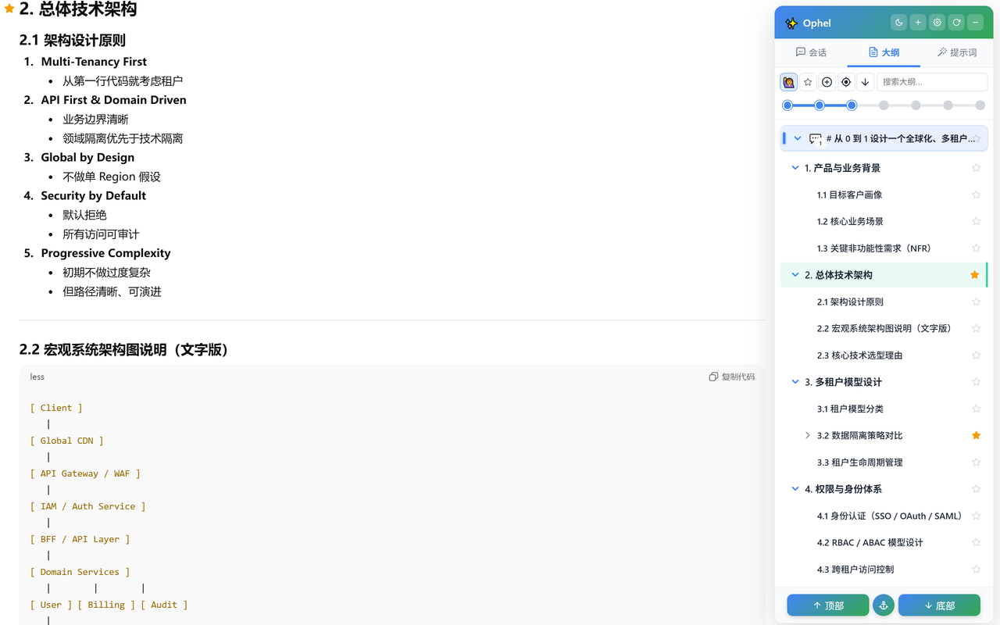
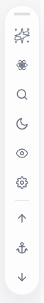
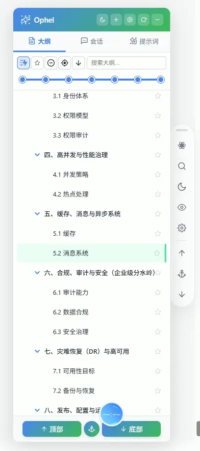
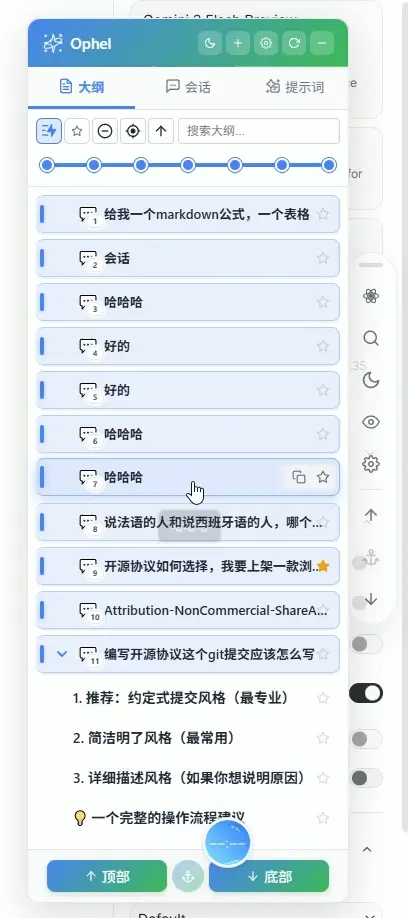

import { Icon } from "/snippets/icon.jsx"
import { Shortcut, ShortcutLegend } from "/snippets/shortcut.jsx"

打开任意支持的 AI 网站后，Ophel 会在页面侧边挂载操作面板。首次安装并确认本地使用声明后，会自动启动 4 步聚光灯引导，带你快速认识 **大纲**、**对话**、**提示词** 和 **设置** 按钮。

<Note>
在触屏设备或窄屏窗口（宽度 `≤ 767px`）下，面板会自动切换为带遮罩的侧滑抽屉；悬浮与自动吸附模式仅适用于桌面宽屏。
</Note>

<ShortcutLegend lang="zh" />

## 三个核心标签页

| 标签页 | 快捷键 | 作用 |
| --- | --- | --- |
| <Icon src="/images/icons/outline.svg" alt="大纲图标" /> **大纲** | <Shortcut combo="alt+1" /> | 实时提取用户提问与 AI 标题，支持折叠、搜大纲、收藏与跳转。 |
| <Icon src="/images/icons/conversation.svg" alt="对话图标" /> **对话** | <Shortcut combo="alt+2" /> | 用文件夹、标签和置顶管理已同步对话，支持批量操作与导出。 |
| <Icon src="/images/icons/prompt.svg" alt="提示词图标" /> **提示词** | <Shortcut combo="alt+3" /> | 管理可复用提示词模板、变量填空、链式提示词与队列发送。 |

- **自定义排序或隐藏**：可以直接在面板标签栏拖拽调整顺序，或在 **设置 → 基本设置 → 面板标签** 中拖拽排序或关闭不需要的标签（至少保留 1 个；只剩 1 个时会自动隐藏标签栏以节省空间）。
- **无对话列表的站点**：Gemini Notebook、智谱清言、腾讯 ima、通义千问、Z.ai 以及当前所有社区适配包均没有侧栏历史列表，会自动隐藏「对话」标签页。

## 面板标题栏

面板顶部栏用于快速控制面板形态与常用入口：

| 区域 / 按钮 | 操作说明 |
| --- | --- |
| **左侧 Ophel 标题** | 点击打开当前版本的更新日志；升级后未查看时会显示红点提示。 |
| **标题栏空白区** | 按住拖动可移动面板位置；**双击**可在 **悬浮模式** 与 **自动吸附** 之间切换（仅桌面端有效）；长按约 0.45 秒会显示穿透点击提示。 |
| <Icon src="/images/icons/snap-to-edge.svg" alt="模式切换图标" /> **模式切换** | 切换悬浮模式 / 自动吸附（<Shortcut combo="alt+m" />）。 |
| <Icon src="/images/icons/theme-dark.svg" alt="主题切换图标" /> **主题切换** | 切换浅色 / 深色主题（<Shortcut combo="alt+d" />）。 |
| <Icon src="/images/icons/new-tab.svg" alt="新标签页图标" /> **新标签页** | 在新标签页打开当前站点首页（需在 **设置 → 功能模块 → 标签页** 中开启「新标签页打开按钮」才会显示）。 |
| <Icon src="/images/icons/settings.svg" alt="设置图标" /> **设置** | 打开设置弹窗（<Shortcut combo="alt+," />）。 |
| <Icon src="/images/icons/minimize.svg" alt="收起图标" /> **收起** | 将面板收进浮动快捷按钮（<Shortcut combo="alt+p" />）。 |

## 浮动快捷按钮

收起面板时（或关闭「面板展开时隐藏快捷按钮」时），屏幕边缘会显示一列浮动快捷按钮：

- **自动收起为星芒水滴**：鼠标离开感应区域 **3 秒**后（或移出浏览器窗口 1.5 秒后），按钮组自动收缩成一颗水滴图标。
- **近距离感应展开**：鼠标靠近感应半径（默认 **150 px**，范围 `0–300 px`）时自动展开；设为 `0` 时，需要把鼠标悬停在水滴上 **300 ms** 才会展开。
- **悬停预览面板**：水滴收起状态下，将鼠标悬停在 Ophel 图标上 **300 ms**，可临时预览面板内容。
- **自由拖动位置**：长按约 0.2 秒即可拖到屏幕任意位置，系统会按相对视口比例记住位置。

按钮顺序、启停、透明度（`40%–100%`）、感应半径与「面板展开时隐藏快捷按钮」（默认 **开启**）均可在 **设置 → 基本设置 → 快捷按钮** 中调整。

### 默认快捷按钮

| 按钮 | 功能 | 默认状态 |
| --- | --- | --- |
| <Icon src="/images/icons/panel-overview.svg" alt="面板图标" /> **展开/收起面板** | 显示或隐藏主面板（<Shortcut combo="alt+p" />） | 开启 |
| <Icon src="/images/icons/floating-toolbar.svg" alt="工具箱图标" /> **工具箱** | 展开快捷工具箱菜单 | 开启 |
| <Icon src="/images/icons/search.svg" alt="搜索图标" /> **全局搜索** | 打开全局搜索（<Shortcut combo="ctrl+k" />） | 开启 |
| <Icon src="/images/icons/theme-light.svg" alt="主题图标" /> **切换主题** | 切换浅色 / 深色主题（<Shortcut combo="alt+d" />） | 开启 |
| <Icon src="/images/icons/eye.svg" alt="禅模式图标" /> **禅模式** | 切换专注无干扰模式（<Shortcut combo="ctrl+shift+z" />） | 开启 |
| <Icon src="/images/icons/settings.svg" alt="设置图标" /> **设置** | 打开设置窗口（<Shortcut combo="alt+," />） | 开启 |
| <Icon src="/images/icons/scroll-top.svg" alt="顶部图标" /> **去顶部** | 跳到对话顶部并记录原位置锚点（<Shortcut combo="alt+t" />） | 开启 |
| <Icon src="/images/icons/anchor.svg" alt="锚点图标" /> **返回锚点** | 回到跳转前的阅读位置（<Shortcut combo="alt+z" />） | 开启 |
| <Icon src="/images/icons/scroll-bottom.svg" alt="底部图标" /> **去底部** | 跳到对话底部并记录原位置锚点（<Shortcut combo="alt+b" />） | 开启 |

### 工具箱菜单

可在 **设置 → 基本设置 → 工具箱** 中开关每一项（默认全部开启）：

| 菜单项 | 功能 |
| --- | --- |
| <Icon src="/images/icons/export.svg" alt="导出图标" /> **导出** | 打开导出对话弹窗（<Shortcut combo="ctrl+shift+e" />）。 |
| <Icon src="/images/icons/folder-move.svg" alt="移动图标" /> **移动** | 将当前对话移动到指定文件夹。 |
| <Icon src="/images/icons/tag.svg" alt="标签图标" /> **设置标签** | 为当前对话添加或移除标签。 |
| <Icon src="/images/icons/scroll-lock.svg" alt="滚动锁定图标" /> **锁定滚动** | 阻止 AI 生成回答时页面自动滚到底部（<Shortcut combo="alt+s" />）。Gemini Notebook 等精简模式站点不显示此项。 |
| <Icon src="/images/icons/model-lock.svg" alt="模型锁定图标" /> **模型锁定** | 快速开关当前站点的自动锁定模型功能。 |
| <Icon src="/images/icons/cleanup.svg" alt="清理图标" /> **清理无效收藏** | 清除原节点已不存在的失效书签。 |
| <Icon src="/images/icons/settings.svg" alt="设置图标" /> **设置** | 打开设置弹窗（始终显示，不可关闭）。 |

## 悬浮模式与自动吸附

可以通过标题栏模式按钮、双击标题栏空白处，或按 <Shortcut combo="alt+m" /> 在两种模式间切换：

- **悬浮模式（默认）**：面板常驻在页面左侧或右侧，拖动面板内侧边缘可在 **240–600 px** 之间自由调宽。开启 **智能避让** 后，页面会自动留出安全区，避免正文被面板遮挡。
- **自动吸附**：把面板拖到屏幕边缘（吸附触发距离内）即可自动收起贴边；需要时把鼠标停在边缘把手（或隐藏触发边）**300 ms** 即可滑出，移开后自动收回。

### 面板尺寸与位置设置

以下选项位于 **设置 → 基本设置 → 面板**：

| 设置项 | 范围 / 选项 | 默认值 | 说明 |
| --- | --- | --- | --- |
| **面板模式** | 悬浮模式 / 自动吸附 | 悬浮模式 | 处于自动吸附模式时，点击此行可展开 **边缘触发方式**（显示把手[默认] / 完全隐藏）。 |
| **默认侧边** | 左侧 / 右侧 | 右侧 | 面板展开与吸附的默认一侧。 |
| **面板宽度** | 240–600 px | 320 px | 处于悬浮模式时，点击此行可展开 **悬停临时加宽（Beta）**（默认 **关闭**）与 **悬停宽度**（240–600 px，默认 **520 px**）。悬停预览不会触发页面避让。 |
| **面板高度** | 50–100 vh | 85 vh | 面板占浏览器可视高度的百分比。 |
| **自动吸附触发距离** | 0–400 px | 30 px | 仅自动吸附模式显示，拖动到距屏幕边缘该距离内自动吸附。 |
| **默认边距** | 0–400 px | 0 px | 仅悬浮模式显示，面板与屏幕边缘的间距。 |

## 穿透点击模式（幽灵模式）

如果面板或浮动按钮恰好盖住了原页面的按钮或链接，**单独按住 <Shortcut combo="ctrl" /> 约 0.2 秒**，Ophel 界面会立即变为半透明，鼠标点击会直接穿透到下方网页。松开按键即可恢复正常交互。

## 全局搜索快捷入口

随时按 <Shortcut combo="ctrl+k" />（或点击浮动搜索按钮）即可跨大纲、已同步对话（含其他平台）、提示词和设置项搜索。也可以在 **设置 → 功能模块 → 全局搜索** 中开启 **双击 Shift** 唤起。

常用语法示例：`type:prompts`、`folder:工作`、`date:30d`。完整语法见[全局搜索](/zh/features/global-search)。

## 扩展工具栏弹窗（Popup）

使用浏览器扩展时，点击浏览器右上角的 Ophel 图标可打开快捷弹窗：

- 查看当前站点状态（已支持 / 已停用 / 未支持），并在多域名站点间快速切换（如 Kimi `.com`/`.ai`、豆包 / Dola）。
- 一键停用或重新启用当前站点，或直接发起新对话。
- 在 **快速访问** 网格中点击直达常用 AI 站点（支持拖拽自定义排序）。
- 一键复制 **最近使用的 3 条提示词**。

## 下一步

<CardGroup cols={2}>
  <Card title="实时大纲" icon="/images/icons/outline.svg" href="/zh/features/outline">
    用大纲树、书签和锚点高效阅读长对话。
  </Card>
  <Card title="对话管理" icon="/images/icons/folder.svg" href="/zh/features/conversations">
    用文件夹、标签和安全清理机制管理对话。
  </Card>
  <Card title="提示词词库" icon="/images/icons/prompt.svg" href="/zh/features/prompts">
    创建变量模板、提示词队列与链式提示词。
  </Card>
  <Card title="快捷键位" icon="/images/icons/keyboard.svg" href="/zh/customization/shortcuts">
    查看并自定义全部 46 个快捷键。
  </Card>
</CardGroup>
